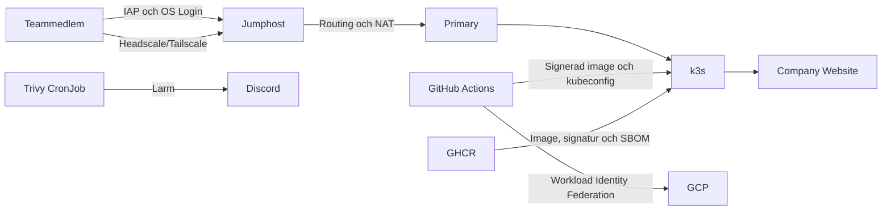

# Team 3 – Blue Team

Detta repository innehåller Team 3:s infrastruktur och säkerhetsarbete i kursen Avancerad IT-säkerhet. Miljön är byggd med Terraform i GCP och består av en jumphost, en intern primary-server med k3s samt säker deployment av applikationen `Team3-ThaCompany`.

Målet har varit att få nätverksskydd, identitet, CI/CD, containersäkerhet, övervakning och incidenthantering att fungera som en sammanhängande lösning.

## Arkitektur



Miljön körs i GCP-projektet `itsx25-comerit`. Primary saknar extern IP och nås via jumphosten. SSH-identitet hanteras med OS Login och infrastrukturen deployas från GitHub Actions med Workload Identity Federation i stället för statiska GCP-nycklar.

## Säkerhetskontroller

- OS Login och separata nivåer för vanlig åtkomst och sudo.
- Begränsade och loggade brandväggsregler.
- VPC Flow Logs för nätverksspårbarhet.
- Skyddad `main` med pull request, granskning och automatiska kontroller.
- Terraform-format, validering, TFLint och Checkov före merge.
- GitHub Actions autentiserar mot GCP genom Workload Identity Federation.
- Container-images byggs med spårbar commit och immutable digest.
- CycloneDX-SBOM skapas och binds till imagen med Cosign.
- Trivy skannar sårbarheter och skickar larm till Discord.
- Applikationsrepots härdning omfattar körning utan root, borttagen service-account-token, seccomp, NetworkPolicy, resursgränser och health checks. Ändringarna ska verifieras efter deployment.

## Repositorystruktur

```text
.
├── .github/workflows/       # PR-kontroller och Terraform-deployment
├── bootstrap/               # Äldre bootstrap för fristående miljö
├── docs/                    # Rapporter och individuella redogörelser
├── headscale/               # Headscale-policy
├── backend.tf               # Terraform-state i GCS
├── main.tf                  # GCP-resurser, nätverk och IAM
├── variables.tf             # Terraform-variabler
└── terraform.tfvars.example # Teamets miljökonfiguration
```

> `bootstrap/` ska inte köras i Comerits delade GCP-miljö. Projektets grund, state-bucket, API:er och CI-identitet hanteras centralt av Comerit.

## CI/CD-flöde

1. En ändring görs i en separat branch.
2. En pull request kör Terraform format, validate, TFLint och Checkov.
3. `main` kräver granskning och godkända kontroller.
4. Efter merge autentiserar deploy-workflowen mot GCP med WIF.
5. Terraform skapar eller uppdaterar Team 3:s resurser.

Applikationen finns i [Team3-ThaCompany](https://github.com/ITSX25-Chas/Team3-ThaCompany). Dess pipeline testar koden, bygger imagen, skapar SBOM, signerar imagen och deployar den till k3s.

## Verifiera infrastrukturen lokalt

Följande kommandon ändrar inte infrastrukturen:

```bash
terraform fmt -check -recursive
terraform init -backend=false
terraform validate
tflint --recursive
checkov -d . --framework terraform
```

Deployment görs av GitHub Actions. Lägg aldrig API-nycklar, kubeconfig, lösenord eller andra hemligheter i repot.

Om en ny primary saknar Kubernetes finns en separat [återställningsguide för k3s](docs/restore-primary-k3s.md).

## Dokumentation för Blue Team-examinationen

- [Säkerhetsrapport – Markdown](docs/blue-team-security-report.md)
- [Säkerhetsrapport – PDF](docs/blue-team-security-report.pdf)
- [Andre Edvardsson – AI-redogörelse](docs/andre-ai-redogorelse.md)
- [Andre Edvardsson – individuellt bidrag](docs/andre-individuellt-bidrag.md)
- [Guide för OS Login](docs/os-login.md)

Git-historik, issues, pull requests och pipelinekörningar används som spårbar evidens för teamets och varje students arbete.

## Red Team-material

Red Team-arbetet är en separat examination men förvaras i samma repository:

- [Red Team pentest-rapport – Markdown](docs/red-team-pentest-report.md)
- [Red Team pentest-rapport – PDF](docs/red-team-pentest-report.pdf)

Blue Team- och Red Team-rapporterna ska inte blandas ihop vid inlämningen.

## Kvarstående risker

De viktigaste kvarstående riskerna beskrivs mer utförligt i säkerhetsrapporten:

- Headscale är fortfarande beroende av manuellt hanterat tillstånd och backup.
- Kubernetes-deploymenten använder fortfarande en långlivad autentisering.
- Full TLS saknas för den interna applikationen.
- Terraform-state och centrala GCP-rättigheter måste verifieras tillsammans med Comerit.
- Riskundantag för sårbarheter måste omprövas när de löper ut eller när en fix blir tillgänglig.

En grön pipeline betyder att de definierade kontrollerna passerade. Det är inte samma sak som att miljön saknar risker.
