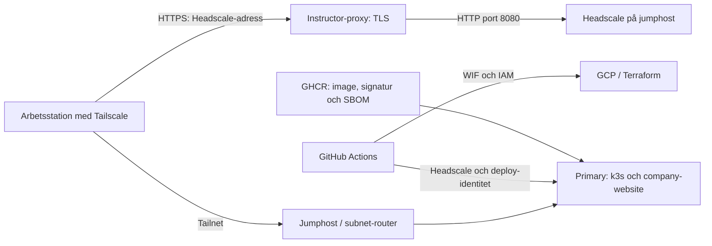

# Säkerhetsrapport – Team 3 Blue Team

**Datum:** 2026-10-13 · **Version:** 2.0 · **Status:** Slutversion för examination

**Omfattning:** Blue Team-arbetet under vecka 4–7: GCP-infrastruktur, åtkomst, Headscale, Kubernetes, CI/CD och övervakning. Applikationssäkerhet ingår där den påverkar driften.

**Informationsklassning:** TLP:CLEAR. Rapporten är sanerad för kursinlämning i ett offentligt repository och innehåller inga lösenord, tokens, privata nycklar eller kubeconfig. Känslig råevidens ska hanteras separat med striktare delning.

## 1. Sammanfattning

Teamet har infört flera säkerhetsåtgärder: OS Login, begränsade nätverksregler, identitetsbaserad CI-autentisering, imagesignering och återkommande sårbarhetsskanning. Vid slutkontroll den 12 oktober var Headscale aktiv, tre noder online och applikationen `1/1 Ready` med fungerande databas. Appen kör som icke-root utan monterad Kubernetes-token. Deploymenten kräver godkända applikationstester. Scannerkonfigurationen hanteras separat av administratör, inte av appens deploykonto.

Sårbarhetsscannern verifierar CycloneDX-attesteringen kryptografiskt mot GitHub Actions OIDC-identitet innan innehållet skannas. Trivy är låst till version `0.75.0`. Åtta granskade CVE:er är tidsbegränsat riskaccepterade till den 10 november 2026; nya eller ej accepterade High/Critical-fynd ger fortsatt rött Discord-larm. Ett grönt larm och ett separat märkt rött testlarm har verifierat larmvägen.

Den tydligaste kvarvarande driftrisken är att Headscales data ligger på jumphostens startdisk. Vid en tidigare ersättning av maskinen behövde tjänsten och klientåtkomsten återställas. Infrastruktur som går att återskapa med Terraform innebär alltså inte att tjänstens identiteter, nycklar och databas automatiskt återställs.

Kvarvarande huvudrisker är Headscales beständighet, breda infra-CI- och app-deploybehörigheter samt avsaknad av Kubernetes NetworkPolicy. Infra-skanningen gjordes blockerande i PR #62. Det planerade bytet av GitHub-organisation och GCP-projekt är också en förändringsrisk som kräver backup, ägarskapskontroll och ny verifiering. Rapporten visar förbättringsbehov, inte att någon angripare har utnyttjat dem.

**Viktig rättelse:** Infra-repots `main` har aktiva GitHub-rulesets med två obligatoriska granskningar och kontrollen `Format & Validate`. En tidigare kontroll av enbart äldre branch protection gav en felaktig bild. PR #62 mergades den 8 oktober och dess root-Terraform deployment lyckades.

### Bedömningsspårbarhet

| Kursmål | Var målet styrks |
|---|---|
| Mål 7 – sammanhängande säkerhetsarkitektur | Avsnitt 3–8 visar sambandet mellan nätverk, identitet, CI/CD, containerskydd, övervakning och incidentrespons. Avsnitt 5 visar kvarstående risk och avvägningar. |
| Mål 8 – agilt säkerhetsprojekt | Avsnitt 10 beskriver backlog, prioritering, arbetsflöde, kvalitetssäkring och retrospektiva förbättringar. Issues, PR:er och commits utgör spårbar evidens. |
| Mål 11 – AI i arbetsflödet | Avsnitt 11 beskriver användningsområden, begränsningar, mänskliga beslut och teknisk verifiering. Den individuella AI-redogörelsen lämnas dessutom separat. |

## 2. Metod och avgränsningar

Underlaget består av versionshanterad konfiguration, PR:er/issues samt kontroller via GitHub, SSH och Kubernetes. Infra-baslinjen är `origin/main`, commit `0db5e0e`. App-baslinjen efter PR #28 är commit `92e67d1`.

Status anges som:

- **Verifierat 8–12 oktober:** direkt observation vid rapportarbetet.
- **Tidigare observation 5 oktober:** behöver kontrolleras igen innan slutlig slutsats om nuläget.
- **Konfigurerat i kod:** visar avsikt, inte i sig att ändringen är applicerad i GCP.
- **Uppgift från teamet:** inte självständigt verifierad i denna kontroll.

Ingen destruktiv testning eller återställning har gjorts. Den tidigare scannerrollen nekade direkt secret-läsning men tillät CronJob-ändringar; detta möjliggjorde indirekt secret-åtkomst. Behörigheten återkallades och verifierades den 10 oktober. Loggtäckning, backupåterställning och samtliga faktiska GCP-rättigheter har inte fullständigt verifierats. En stängd issue eller grön pipeline är inte ensam bevis på att en risk är åtgärdad.

## 3. Miljön och skyddsgränserna



Jumphosten har intern adress `10.0.3.2`, primary `10.0.3.3` och instructor-proxy `10.0.0.2`. Headscale ger klienterna medlemskap och nätverksinformation; OS Login hanterar SSH-identitet och VM-behörighet. Att vara ansluten till Tailnet innebär inte automatiskt sudo-rättigheter.

TLS för Headscale termineras på instructor-proxy. Avsaknad av nginx eller port 443 på jumphosten är därför inte ensam ett fel. Spectre är en separat tjänst: fungerande SSH till jumphosten bevisar inte att DNS, subnet-routing och åtkomst till Spectre fungerar.

## 4. Införda skydd och verifieringsläge

| Område | Underlag och status | Begränsning |
|---|---|---|
| SSH-identitet | OS Login aktiverat i kod för jumphost och primary; PR #54 och #50 | Fullständig aktuell IAM-granskning återstår |
| Granskning av infra | Aktiva rulesets: två godkännanden, `Format & Validate`, skydd mot radering och force-push | Eventuella bypass-aktörer inte granskade |
| CI-autentisering | WIF finns; tidigare Editor-roll ersatt i PR #57; PR #62 begränsar WIF-koden till `main` | `roles/compute.admin` är fortfarande projektomfattande; bootstrap-ändringen är inte verifierad som applicerad |
| Infra-kontroller | PR #62 gör TFLint och Checkov blockerande; deploykörning `37777508119` lyckades | Dokumenterade Checkov-undantag måste omprövas när förutsättningarna ändras |
| Nätverksåtkomst | Begränsade SSH-källor, IAP-regel och Headscale-ACL i kod; PR #49 och #53 | Faktisk åtkomst bör testas från varje användarroll |
| Terraform-state | Public access prevention, uniform bucket access, versionering och loggning i bootstrap-kod; PR #60 | Aktiv molnkonfiguration inte omverifierad; issue #12 fortfarande öppen |
| Loggning | VPC Flow Logs i kod, PR #55 | Insamling, retention och larmleverans behöver verifieras |
| Signering och SBOM | App-repots PR #11 och #13 inför signering och SBOM-attestering | Signatur betyder inte att imagen saknar sårbarheter |
| Appkonton | PR #24 kontrollerar `enabled` även när en befintlig session laddas | Administrativ process för att avaktivera konton behöver dokumenteras |
| App-deployment | PR #24 kräver godkända tester före deploy-jobbet; 22 tester passerade | Separat GitHub-ruleset för app-repot bör fortfarande övervägas |
| Containerhärdning | PR #27: UID/GID 10001, `RuntimeDefault` seccomp, alla capabilities borttagna, privilege escalation nekad och service-account-token avstängd | NetworkPolicy saknas fortfarande |
| Drift | Headscale `active`, tre noder online; company-website `1/1` och `/healthz` frisk den 12 oktober | Ögonblicksbild, inte tillgänglighetsmätning |
| Scanner | PR #25–#28: verifierad attestering, Trivy `0.75.0`, separat administration och tidsbegränsad riskacceptans | Tredjeparts-SBOM kan påverka träffsäkerheten; 43 Debian-paketträffar kvarstår |
| Larmväg | Grönt larm och separat rött testlarm levererades; testjobbet avslutades `Complete` | Testlarm bevisar leverans, inte upptäckt av ett verkligt intrång |

Scanner-schemat är `0 12 * * *` utan explicit tidszon. Anta inte att detta betyder klockan 12 svensk tid; välj och dokumentera önskad tidszon.

## 5. Prioriterade kvarvarande risker

Bedömningarna är kvalitativa och relativa till labbmiljön, inte CVSS-poäng.

### B01 – Headscale-state riskerar att försvinna vid VM-ersättning

**Prioritet: Hög.** Den 8 oktober låg `/var/lib/headscale` på `/dev/sda1`, monterad som `/`. Ingen separat beständig Headscale-volym finns deklarerad i granskad main-konfiguration. Teamet uppger att Headscale installerats manuellt.

**Konsekvens:** förlorade registreringar, förändrad serveridentitet och avbrott för klienter och deployment. En ersatt databas kan också ändra användar-ID:n som pipelines förlitar sig på.

**Åtgärd:** automatisera installation och konfiguration; säkerhetskopiera konfiguration, policy, Noise-nyckel och SQLite konsekvent. Kopiering av endast databasfilen under pågående skrivning är inte tillräcklig när WAL används. Beakta även Tailscale-routerstate. Kryptera backup och begränsa åtkomsten.

**Klart när:** återställning på en separat testmaskin demonstrerats och en dokumenterad väg in finns även när Tailnet inte fungerar.

### B02 – Infra-CI har stor behörighetsyta

**Prioritet: Hög.** Bootstrap-koden ger CI `roles/compute.admin` på projektnivå. PR #62 begränsar WIF-villkoret i kod till rätt repository och `refs/heads/main`, men den vanliga workflowen kör root-konfigurationen och applicerar inte automatiskt `bootstrap/`. Den aktiva WIF-konfigurationen behöver därför verifieras separat.

**Konsekvens:** komprometterad eller felaktig pipeline kan påverka fler Compute-resurser än teamets avsedda ändring.

**Åtgärd:** kartlägg nödvändiga API-operationer, begränsa rollen där möjligt och bind produktionsautentisering till avsedd branch/miljö. Granska också bootstrap separat: merge i app- eller infra-root applicerar inte automatiskt en annan Terraform-root.

**Klart när:** tillåtna deploys fungerar och ett test från otillåten kontext nekas utan att reservåtkomsten förloras.

### B03 – Blockerande infra-kontroller kräver fortsatt förvaltning

**Prioritet: Låg efter åtgärd.** PR #62 tog bort `continue-on-error` för TFLint och satte Checkov `soft_fail: false`. Kontrollerna blockerar därmed PR:n när de hittar ett icke-undantaget fel.

**Restrisk:** undantag kan dölja relevanta fynd om motiveringen blir inaktuell. Granska undantagen regelbundet och verifiera skyddet med ett avsiktligt fel i en test-PR.

### B04 – Appens deploy-identitet behöver begränsas

**Uppdatering 12 oktober:** möjligheten att skapa/patcha scanner-CronJobs gav indirekt åtkomst till monterade secrets, även när direkt secret-läsning nekades. PR #26 tog bort scanner-apply från appens pipeline och tömde den tidigare scannerrollen och dess binding. Deploykontot nekas nu patch av CronJobs i `security-tools`. Kontroll på primary visar dock fortfarande `yes` för läsning av secrets och skapande av pods i `default`.

**Prioritet: Hög, verifierad kvarvarande risk.** Deployidentiteten kan läsa applikationssecrets och skapa pods i `default`. En komprometterad pipeline kan därmed få större åtkomst än vad vanlig deployment kräver.

**Åtgärd:** minimera RBAC, skilj engångs-bootstrap från vanlig deployment och utred kortlivade autentiseringsuppgifter. Secrets ska aldrig kopieras in i rapporter. Teamets `HEADSCALE_API_KEY` och `HEADSCALE_USER_ID` får inte ändras utan samordning.

### B05 – Otillräcklig isolering i Kubernetes

**Prioritet: Medel, delvis åtgärdad.** Ingen NetworkPolicy hittades den 12 oktober. PR #27 åtgärdade containerdelen: appen kör som UID 10001, saknar service-account-token, tappar alla capabilities och använder `RuntimeDefault` seccomp.

**Konsekvens:** en applikationskompromettering kan ge onödig nätverksåtkomst och större påverkan inom containern.

**Åtgärd:** inför testad nätverkssegmentering som bevarar DNS, ingress och nödvändiga externa anslutningar. Behåll non-root- och tokenkontrollerna i CI.

### B06 – Kvarvarande begränsningar i scannerresultatet

**Uppdatering 12 oktober:** den ursprungliga imagen hade 48 High-träffar och 0 Critical. PR #26 tog bort fyra Python-träffar och PR #27 tog bort en oanvänd biblioteksträff. Aktuell CI-skanning visar 43 High och 0 Critical, motsvarande åtta unika granskade CVE:er. Produktionsdeployment, hälsa och scannerjobb är verifierade. Imagen är inte sårbarhetsfri.

**Prioritet: Låg efter åtgärd.** Den tidigare konfigurationen använde `--ignore-unfixed`, litade på en nedladdad attestering utan verifiering och hämtade Trivys installationsskript från `main`. Detta åtgärdades i PR #25: attesteringen verifieras mot GitHub OIDC, Trivy är låst till `0.75.0` och ofixade fynd inkluderas.

**Verifiering:** den äldre pipelinekörningen `37780041665` passerade då inklusive automatisk CronJob-apply. Den behörigheten har därefter återkallats. Jobbet `sbom-vulnerability-scanner-hardened-20261008` verifierade attesteringen och `sbom-warning-test-20261008` levererade ett märkt rött testlarm utan att skapa en sårbar workload. Efter PR #28 avslutades även riskacceptansens verifieringsjobb `Complete`.

**Restrisk:** installationsskriptet hämtas fortfarande vid körning, fast från en versionstagg. Högre assurance kräver checksummeverifierad binär eller en egen förbyggd scannerimage. CycloneDX-SBOM skapas av Anchore och Trivy loggar därför en varning om tredjeparts-SBOM. Ett grönt resultat betyder att den aktuella konfigurationen inte hittade High/Critical-fynd; det bevisar inte att imagen saknar alla sårbarheter.

### B07 – State-bucketens aktiva skydd kan inte verifieras av teamet

**Prioritet: Hög inför miljöbytet.** Bootstrap-koden innehåller public access prevention, uniform bucket access, versionering, access-loggning och explicit IAM. Vid kontroll nekades teamkontot däremot både `storage.buckets.get` och `storage.buckets.getIamPolicy` på state-bucketen. Endast projektadministratör kan därför bekräfta eller applicera skydden. Issue #12 är korrekt fortsatt öppen.

**Konsekvens:** teamet kan inte självständigt visa att kod och aktiv bucket överensstämmer eller granska vilka som kan läsa historiska state-versioner.

**Åtgärd och klart-kriterium:** ny GCP-administratör granskar en bootstrap-plan, applicerar den i rätt projekt och verifierar public access prevention, loggleverans, lifecycle och IAM. Terraform-state ska säkerhetskopieras och migreras kontrollerat innan den gamla miljön tas bort.

## 6. Incidenter och lärdomar

### Paketvis bedömning av 43 High-träffar, 10–12 oktober

**Verifierad härdning:** [PR #27](https://github.com/Kurs6-Projekt/Team3-ThaCompany/pull/27) är mergad och [deployment 38042577862](https://github.com/Kurs6-Projekt/Team3-ThaCompany/actions/runs/38042577862) lyckades. Appen kör som UID/GID 10001 med borttagen service-account-token, drop ALL capabilities, nekad privilege escalation och RuntimeDefault seccomp. Endast libncursesw6 togs bort, inte essentiella Debian-paket. Två konsistenta SQLite-backuper skapades på datavolymen innan ägarskapet ändrades. Efter deployment verifierades `uid 10001`, saknad token, databasläsning/skrivning, `1/1 Ready` och frisk `/healthz`.

Underlag: CI-run `38039546822`, runtime-kontroll på appcontainern och Debian Security Tracker. De 43 aktuella träffarna motsvarar **8 unika CVE:er**, inte 43 separata säkerhetshål.

| Källpaket | Träffar | Bedömning och nästa åtgärd |
| --- | ---: | --- |
| util-linux | 36 | Fyra CVE:er upprepas över nio binärpaket: CVE-2026-76642, -78408, -78409 och -78410. Trixie fortfarande markerad vulnerable; fix finns i nyare Debian-gren. Kräver lokala/privilegierade mount- eller nsenter-förutsättningar. Exploaterbarhet i appen inte fastställd. |
| ncurses | 3 | CVE-2025-69720 gäller verktyget infocmp; Debian klassar det som minor/no-dsa för Trixie. Biblioteksträffarna betyder inte automatiskt att Flask använder den sårbara kodvägen. |
| systemd | 2 | CVE-2026-16742 gäller systemd-homed, som saknas i appcontainern enligt runtime-kontroll. Behåll fyndet synligt men dokumentera den saknade komponenten. |
| perl | 1 | CVE-2026-9538 gäller Archive::Tar. `perl -MArchive::Tar -e 1` bekräftade att modulen saknas. Inte en verifierad exploaterbar kodväg i appcontainern. |
| acl | 1 | CVE-2026-54369 gäller privilegierade ACL-operationer via manipulerade sökvägar. libacl1 krävs av basverktyg; ingen exploaterbar appkodväg verifierad. |

`apt-get -s purge` (endast simulering) nekade borttagning av de berörda paketen på grund av beroenden från bland annat coreutils, bash, apt och util-linux. Att tvinga bort dem eller blanda stable med unstable är inte en verifierad säker åtgärd.

**Rekommenderat:** utvärdera en ännu mindre runtime-image och bevaka Trixies säkerhetsuppdateringar. Non-root och capability-begränsning är redan applicerade. Att minska scannerantalet är inte i sig bevis på minskad exploaterbarhet.

**Larmhantering:** [app-PR #28](https://github.com/Kurs6-Projekt/Team3-ThaCompany/pull/28) inför exakta undantag för de åtta granskade CVE:erna. Undantagen upphör `2026-11-10` och innehåller motivering. Den fullständiga rapporten skapas fortfarande, medan Discord endast ger rött larm för nya eller ej accepterade High/Critical-fynd och visar antalet accepterade paketträffar. Verifieringsjobbet `sbom-vulnerability-scanner-risk-acceptance-20261010` blev `Complete`; webhook-anropet är felblockerande. De 43 träffarna är riskaccepterade, inte åtgärdade eller borttagna.

Källor: [util-linux](https://security-tracker.debian.org/tracker/CVE-2026-76642), [nsenter](https://security-tracker.debian.org/tracker/CVE-2026-78408), [subdir mount](https://security-tracker.debian.org/tracker/CVE-2026-78409), [bind mount](https://security-tracker.debian.org/tracker/CVE-2026-78410), [ncurses](https://security-tracker.debian.org/tracker/CVE-2025-69720), [systemd](https://security-tracker.debian.org/tracker/CVE-2026-16742), [Perl](https://security-tracker.debian.org/tracker/CVE-2026-9538), [ACL](https://security-tracker.debian.org/tracker/CVE-2026-54369).

### Verifierad appuppdatering 10 oktober

Post-deploy-jobbet `sbom-vulnerability-scanner-postdeploy-20261010` avslutades `Complete` efter 66 sekunder. Verifieringsjobbet efter riskacceptansen avslutades också `Complete` och webhook-anropet var felblockerande.

[PR #26](https://github.com/Kurs6-Projekt/Team3-ThaCompany/pull/26) är mergad. [Deployment 38038431812](https://github.com/Kurs6-Projekt/Team3-ThaCompany/actions/runs/38038431812) lyckades efter omkörning av ett tillfälligt BuildKit-pullfel. Appen är `1/1 Ready`, `/healthz` svarar `healthy` och `db: connected`. Runtime-kontroll bekräftar att pip inte finns installerat. SSH via jumphosten till primary fungerar efter ändringen. Ingen Headscale-nyckel eller OS Login-behörighet ändrades.

### Secure Boot: VM startad men operativsystemet startade inte

Issue #32 beskriver GRUB-/signaturfel efter aktivering av Secure Boot. En VM som visas som `RUNNING` är inte bevis på att SSH eller operativsystemet fungerar. Secure Boot stängdes av; vTPM och integritetsövervakning behölls i jumphost-konfigurationen.

Lärdom: testa startkedjan med den faktiska labbimagen innan kravet införs. Återaktivering kräver en kompatibel signerad startkedja och verifierad återställningsväg. Exakt avbrottslängd är inte fastställd här.

### Ersatt jumphost och återregistrering av Headscale

Zonflytten i PR #61 ersatte jumphosten. Teamets uppgifter och tidigare felsökning beskriver ominstallation av Headscale, nya registreringar och ändrat `github-ci`-ID. Teamet uppger att app-pipelinen återställdes genom ny API-nyckel och uppdaterat användar-ID.

Lärdom: behandla databas och servernycklar som kritiskt beständigt tillstånd. Dokumentera beroenden mellan Terraform, Headscale och GitHub-secrets. Underlaget visar drift-/konfigurationsproblem, inte ett bekräftat intrång.

### DNS-fel för Spectre efter ominstallation

Den 12 oktober löstes `spectre.itsx25.chas-lab.dev` till den publika adressen och gav `403`, medan samma hostname mot interna `10.0.0.2` gav `200`. Headscale hade återgått till `base_domain: example.com`, en felaktig split-DNS-regel och tomma extra records. Konfigurationen säkerhetskopierades, validerades med `headscale configtest` och korrigerades till `team3.arpa` med explicita poster för Spectre och company-website. Tjänsten laddades om utan att noder eller serveridentitet ersattes.

Lärdom: live-konfiguration som inte finns i Git/Terraform riskerar att förloras vid VM-ersättning. Klienterna måste dessutom välja `accept-dns=true`; serverkonfiguration ensam ändrar inte klientens DNS-policy.

## 7. Loggning och detektion

| Händelse att upptäcka | Underlag | Föreslaget test |
|---|---|---|
| Oväntad SSH-åtkomst | OS Login-policykontroller tillsammans med sshd-journal | Känd testinloggning ska kunna följas till rätt konto och VM |
| Ändrad molnbehörighet | GCP Audit Logs för IAM och servicekonton | Kontrollerad behörighetsändring ska synas med aktör |
| Headscale-avbrott | Extern hälsokontroll och tjänstejournal | Larm utan beroende av det felande Tailnet |
| Ny sårbar image | Verifierad SBOM, scannerresultat och image-digest | Grönt och rött leveranstest verifierade Discord-vägen; verkligt fynd ska skapa åtgärdsärende |
| Oväntad deployment | GitHub-körning, image-digest och klustertillstånd | Driftsatt image ska kunna kopplas till commit och körning |

OS Login `CheckPolicy` visar en behörighetskontroll, inte ensamt en lyckad interaktiv SSH-session. Korrelatera med serverloggar. Scannerjobben kan följas med `kubectl get jobs` och `kubectl logs`; Discord är larmkanal, inte ensam evidenslagring. Verifiera retention, åtkomst och vem som hanterar larmen. Spara inte tokens eller kompletta credentials i loggar.

### Incidentflöde

1. **Upptäck:** Discord, GitHub Actions, GCP Audit Logs eller tjänstehälsa signalerar avvikelsen.
2. **Triagera:** koppla händelsen till användare, commit, image-digest, pod och tidsstämpel; bevara relevanta loggar utan hemligheter.
3. **Begränsa:** stoppa berörd deployment eller återkalla den minsta berörda identiteten. Behåll separat reservåtkomst så att teamet inte låses ute.
4. **Åtgärda:** patcha i branch, granska via PR och bygg en ny signerad image. Ändra eller rotera credentials om exponering misstänks.
5. **Återställ:** deploya godkänd artefakt och verifiera health checks, databas, åtkomst och larmväg.
6. **Lär:** dokumentera rotorsak, evidens, kvarstående risk och förbättring som issue/retrospektiv.

Flödet testades delvis genom rött leveranstest, scannerlarm, återställning av deployment och flera kontrollerade konfigurationsändringar. En fullständig tabletop-övning med roller, eskalering och återställning återstår.

## 8. MITRE ATT&CK och Threat Intelligence

Mappningen nedan beskriver möjliga angreppssätt, inte observerade attacker mot teamet.

| Risk | Relevant teknik | Koppling till miljön |
|---|---|---|
| B02 | T1078.004 – Valid Accounts: Cloud Accounts | Missbruk av en giltig molnidentitet kan utnyttja dess breda rättigheter |
| B04 | T1552.001 – Unsecured Credentials: Credentials In Files | Token eller kubeconfig som exponeras i filer kan ge åtkomst |
| B04–B05 | T1610 – Deploy Container | En komprometterad identitet med pod-skapande kan användas för en oönskad container |

MITRE beskriver verkliga exempel på missbruk av molnkonton, bland annat kopplade till APT29. Det gör identitetsbegränsning relevant även när inga lösenord finns i Terraform. Det innebär inte att teamet har utsatts av denna aktör. [MITRE T1078.004](https://attack.mitre.org/techniques/T1078/004/)

MITRE beskriver också containerdeployment i angrepp, bland annat med Kinsing. För teamet motiverar detta begränsad deploy-RBAC och isolering, men ingen sådan aktivitet har belagts här. [MITRE T1610](https://attack.mitre.org/techniques/T1610/)

Filer med autentiseringsuppgifter är en etablerad åtkomstväg. Därför ska tokenhantering och backupskydd ingå i Blue Team-arbetet. [MITRE T1552.001](https://attack.mitre.org/techniques/T1552/001/)

**Tillförlitlighet:** miljöobservationer från den 12 oktober har starkast stöd för nuläget. Tidigare kontroller kan ha förändrats. Angreppskopplingarna är analytiska hypoteser. Inga egna indikatorer på intrång eller angriparattribution presenteras.

## 9. Informationsdelning och TLP

TLP styr delning, inte hur allvarlig en sårbarhet är. Rapporten klassas TLP:CLEAR eftersom den är avsedd för kursinlämning i ett offentligt repository och har sanerats från hemligheter. TLP:CLEAR innebär att mottagaren får sprida informationen utan begränsning, med hänsyn till vanliga upphovsrättsregler. [FIRST TLP](https://www.first.org/tlp/)

Råloggar, skärmbilder och bilagor ska granskas separat innan publicering. Lösenord, API-nycklar, privata nycklar och kubeconfig ska aldrig ingå, oavsett TLP-märkning. Rapporten innehåller inga sådana hemligheter.

## 10. Projektgenomförande och agilt arbetssätt

Arbetet bedrevs som ett lättviktigt Kanban-flöde i GitHub. Säkerhetsbehov dokumenterades som issues, avgränsades i branches och implementerades genom pull requests. Pipelinekontroller och praktiska drifttest fungerade som kvalitetsgrindar. Git-historiken visar både planerade förbättringar och mindre korrigeringar efter återkoppling.

| Moment | Genomförande | Evidens/exempel |
|---|---|---|
| Backlog | Brister och förbättringar registrerades som issues med säkerhets- och Terraformetiketter | Issue #12 och #32 samt stängda säkerhetsärenden |
| Prioritering | Åtkomstförlust och fungerande deployment hanterades först, därefter least privilege, detektion och härdning | Zonflytt PR #61, CI/WIF PR #62, app-PR #24–#28 |
| Iteration | Små branches och PR:er användes för att ändra en avgränsad kontroll i taget | OS Login, Flow Logs, SBOM, Cosign, scanner och non-root infördes separat |
| Kvalitetssäkring | Terraform fmt/validate, TFLint, Checkov, apptester, container-smoke-test, Trivy, Cosign och live health checks | GitHub Actions-körningar i avsnitt 14 |
| Definition of Done | Kod mergad, pipeline grön och relevant kontroll verifierad i drift; kvarvarande risk dokumenterad | `1/1 Ready`, `/healthz`, RBAC `can-i`, scannerjobb och Headscale `configtest` |

### Riskprioritering

Prioriteringen utgick från sannolik påverkan på åtkomst, hemligheter och drift. Hög prioritet gavs åt förlorad Headscale-state, breda CI-identiteter och deploy-RBAC. Medel gavs åt nätverksisolering. Scannerbegränsningar bedömdes lägre efter att attestering och larmväg verifierats. Riskacceptans användes endast när fix saknades eller när sårbar kodväg inte fanns i containern; undantagen fick motivering och slutdatum.

### Retrospektiv

- **Det som fungerade:** små PR:er, signerade artefakter, blockerande tester och direkta driftkontroller gav snabb återkoppling och tydlig historik.
- **Det som skapade problem:** Headscale låg utanför Infrastructure as Code, bootstrap var separerad från ordinarie Terraform-root och vissa gröna pipelines misstolkades först som bevis på aktiv molnkonfiguration.
- **Förbättring efter lärdom:** scanneradministration separerades från appdeployment, non-root infördes först efter backup och skrivtest, DNS ändrades först efter backup och `configtest`, och rapporten skiljer nu konsekvent mellan kod, applicerad kontroll och riskacceptans.
- **Nästa sprint:** backup/återställning, minskad deploy-RBAC, NetworkPolicy samt kontrollerad flytt av GitHub- och GCP-miljön.

En begränsning är att sprintmål och retrospektiv inte dokumenterades konsekvent från projektets första dag. Issues, PR:er och Git-historik gör processen möjlig att följa, men kommande arbete bör använda milstolpar, ansvarig och acceptanskriterier redan när ett ärende skapas.

## 11. Generativ AI och AI-assisterade säkerhetsverktyg

Generativ AI användes som parprogrammerare för kodgranskning, hypotesbildning vid felsökning, förslag på Terraform/Kubernetes-konfiguration, formulering av testfall och strukturering av rapporten. AI kombinerades med deterministiska verktyg: Checkov och TFLint för IaC, Trivy för sårbarheter, Cosign för signatur/attestering, pytest för applikationslogik samt `kubectl`, `gcloud`, `curl` och systemjournaler för faktisk driftstatus.

AI bedömdes lämplig när uppgiften var att snabbt hitta möjliga fel, jämföra alternativ eller skapa ett första förslag. Den bedömdes olämplig som ensam beslutsfattare för IAM, riskacceptans, hemligheter, destruktiva åtgärder eller påståenden om aktiv molnkonfiguration. Exempelvis accepterades inte förslaget att tvinga bort Debian-basberoenden enbart för att minska scannerantalet. Paketborttagning simulerades, Debian Security Tracker kontrollerades och risken reducerades i stället med non-root, seccomp och borttagna capabilities.

AI-svar kvalitetssäkrades genom följande kedja:

1. Påståendet jämfördes med repositorykod eller primär dokumentation.
2. Ändringen granskades som diff och genom statisk validering.
3. Tester eller server-side dry-run kördes före applicering.
4. Backup och återställningsväg säkrades vid tillståndsbärande ändringar.
5. Resultatet verifierades i drift och dokumenterades med commit, PR eller jobb-ID.

AI förbättrade hastighet och bredd men skapade också risk för övertygande fel, för breda kommandon och förväxling mellan konfigurerat och applicerat. Mänsklig granskning och verktygsbaserad evidens var därför obligatorisk. Inga hemligheter återges i rapporten; känsliga värden ska inte användas som underlag för AI och exponerade autentiseringsuppgifter ska spärras/roteras enligt ordinarie incidentprocess.

## 12. Individuell spårbarhet

Bedömningen ska göras per student. Rapporten tillskriver därför inte en gruppmedlem arbete enbart utifrån muntliga uppgifter. Bidrag styrks med committar, PR-författare, reviews, issues och dokumenterad verifiering. Varje student anger i Canvas vilka delar som är dennes och länkar till relevanta objekt.

Praktiska kommandon för granskning:

```bash
git shortlog -sne --all
git log --author="NAMN_ELLER_EPOST" --oneline --all
```

För Andre finns exempelvis spårbara commits för OS Login på primary (`0e6b150`), VPC Flow Logs (`d2a91fb`), GitHub-runner-ACL (`41c066e`), blockerande CI/WIF (`f8feff5`, `037a16d`, `6e85d55`) samt appens SBOM/Cosign, scannerhärdning och non-root-arbete i app-repot. Den separata individuella redogörelsen sammanfattar dessa utan att ersätta Git-historiken.

## 13. Föreslagen åtgärdsplan

Tiderna är förslag från rapportdatum, inte beslutade leveranslöften.

| När | Åtgärd | Föreslagen ansvarig | Godkännandekriterium |
|---|---|---|---|
| Inom en vecka | Backup och återställning av Headscale | Infrastrukturansvarig | Återställning demonstrerad i separat testmiljö |
| Inom en vecka | Flytta appens SQLite-backup till separat, krypterad lagringsplats och återställningstesta | Driftansvarig | Återställd kopia klarar integritetskontroll och apptest |
| Inom en vecka | Applicera/verifiera bootstrap-WIF och minska Compute-behörigheten | Två utsedda granskare | Endast rätt repo/main får autentisera; normal deploy fungerar |
| Inom en vecka | Minska kvarvarande deploy-RBAC i `default` och utred kortlivad Kubernetes-identitet | CI/Kubernetes-ansvarig | Deployment fungerar utan onödiga pod-/secret-rättigheter |
| Inom två veckor | Inför och testa container-/nätverksisolering | Kubernetes-ansvarig | App fungerar; otillåten testtrafik blockeras |
| Inom två veckor | Bygg checksummeverifierad scannerimage och dokumentera larmhantering | Övervakningsansvarig | Samma scannerartefakt används reproducerbart och larm får ägare |
| Före miljöbytet | Spegla repon och inventera Actions-secrets, variables, packages, WIF, Terraform-state och administratörer | Repoägare och infrastrukturansvarig | Ny GitHub-organisation och nytt GCP-projekt fungerar utan att gamla miljön först raderas |
| Efter varje större ändring | Uppdatera evidens och riskacceptans | Hela gruppen | Rapport, issues och verklig konfiguration överensstämmer |

## 14. Evidens och referenser

Infra: [repository](https://github.com/Kurs6-Projekt/team3-blueteam), [baslinje 0db5e0e](https://github.com/Kurs6-Projekt/team3-blueteam/tree/0db5e0e).

- [PR #49: ACL](https://github.com/Kurs6-Projekt/team3-blueteam/pull/49), [#50: gamla SSH-nycklar](https://github.com/Kurs6-Projekt/team3-blueteam/pull/50), [#54: OS Login primary](https://github.com/Kurs6-Projekt/team3-blueteam/pull/54).
- [PR #53: runner-ACL](https://github.com/Kurs6-Projekt/team3-blueteam/pull/53), [#55: Flow Logs](https://github.com/Kurs6-Projekt/team3-blueteam/pull/55), [#57: CI-roll](https://github.com/Kurs6-Projekt/team3-blueteam/pull/57).
- [PR #60: state-bucket](https://github.com/Kurs6-Projekt/team3-blueteam/pull/60), [issue #12](https://github.com/Kurs6-Projekt/team3-blueteam/issues/12), [PR #62: CI- och WIF-hardening](https://github.com/Kurs6-Projekt/team3-blueteam/pull/62), [infra-pipeline 37777508119](https://github.com/Kurs6-Projekt/team3-blueteam/actions/runs/37777508119).
- [Issue #32: Secure Boot](https://github.com/Kurs6-Projekt/team3-blueteam/issues/32), [PR #61: zonflytt](https://github.com/Kurs6-Projekt/team3-blueteam/pull/61), [körning 36853609140](https://github.com/Kurs6-Projekt/team3-blueteam/actions/runs/36853609140).
- App: [PR #11: Cosign](https://github.com/Kurs6-Projekt/Team3-ThaCompany/pull/11), [#13: SBOM](https://github.com/Kurs6-Projekt/Team3-ThaCompany/pull/13), [#20: beroenden](https://github.com/Kurs6-Projekt/Team3-ThaCompany/pull/20), [#24: sessioner och deploykontroller](https://github.com/Kurs6-Projekt/Team3-ThaCompany/pull/24), [#25: härdad scanner](https://github.com/Kurs6-Projekt/Team3-ThaCompany/pull/25), [#26: scannerisolering och basimage](https://github.com/Kurs6-Projekt/Team3-ThaCompany/pull/26), [#27: non-root](https://github.com/Kurs6-Projekt/Team3-ThaCompany/pull/27), [#28: tidsbegränsad riskacceptans](https://github.com/Kurs6-Projekt/Team3-ThaCompany/pull/28).
- [App-pipeline 38042577862](https://github.com/Kurs6-Projekt/Team3-ThaCompany/actions/runs/38042577862): non-root-image, tester, SBOM, signering och deployment passerade. [Pipeline 38055948795](https://github.com/Kurs6-Projekt/Team3-ThaCompany/actions/runs/38055948795) verifierade slutläget efter PR #28.

Kontroller den 8–12 oktober: GitHub effective rules för `main`, `systemctl is-active headscale`, `headscale configtest`, `findmnt -T /var/lib/headscale`, interna och publika DNS-/HTTP-test, `kubectl get deploy`, scannerjobb, `kubectl get networkpolicy -A` samt RBAC-test med `kubectl auth can-i`. Råloggar innehåller inga hemligheter i rapporten; relevanta jobbnamn och pipeline-ID finns ovan för spårbarhet.

**Slutsats:** Miljön är i drift och flera skydd är verifierade. Leveranskedjan har tester före deployment, signerad och verifierad SBOM, versionslåst skanning och testad larmleverans. Appcontainern är tydligt härdad jämfört med utgångsläget. Rapporten bedöms färdig för inlämning, men miljön är inte riskfri. Högst prioritet är verifierbar Headscale- och databasåterställning, minskade infra- och Kubernetes-behörigheter, nätverksisolering samt kontrollerad flytt till ny GitHub-organisation och nytt GCP-projekt.
