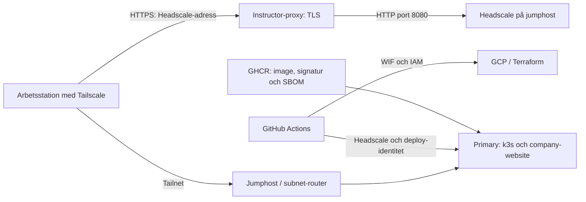

# Säkerhetsrapport – Team 3 Blue Team

**Datum:** 2026-11-03 · **Version:** 2.2 · **Status:** Slutversion för examination

**Omfattning:** Blue Team-arbetet under vecka 4–7: GCP-infrastruktur, åtkomst, Headscale, Kubernetes, CI/CD och övervakning. Applikationssäkerhet ingår där den påverkar driften.

**Informationsklassning:** TLP:CLEAR. Rapporten är sanerad för kursinlämning i ett offentligt repository och innehåller inga lösenord, tokens, privata nycklar eller kubeconfig. Känslig råevidens ska hanteras separat med striktare delning.

## 1. Sammanfattning

Teamet har infört OS Login, begränsade nätverksregler, identitetsbaserad CI-autentisering, imagesignering, SBOM, NetworkPolicy och återkommande sårbarhetsskanning. Efter flytten till Comerits GCP-projekt återställdes k3s på nya primary den 3 november. En ny subnet-router tog över `10.0.3.0/24`, kubeconfig roterades och appdeployment [41608640621](https://github.com/ITSX25-Chas/Team3-ThaCompany/actions/runs/41608640621) passerade tester, SBOM, Cosign, policykontroll och rollout. Slutkontrollen visade nod `Ready`, app `1/1`, aktiv NetworkPolicy, Sigstore-policy i `enforce` och HTTP 200.

Sårbarhetsscannern verifierar CycloneDX-attesteringen kryptografiskt mot GitHub Actions OIDC-identitet innan innehållet skannas. Trivy är låst till version `0.75.0`. En ombyggd image skannades den 3 november: 44 High-paketträffar, nio unika CVE:er och 0 Critical. De nio granskade CVE:erna har tidsbegränsade undantag till den 20 november 2026. Ett grönt larm och ett separat märkt rött testlarm verifierade larmvägen i den tidigare driften.

**Driftstatus 13 november:** scannerkoden och riskundantagen finns kvar i GitHub, men namespace `security-tools`, scanner-CronJobben och Discord-secreten saknas i det återställda klustret. Den dagliga skanningen och larmningen körs därför inte just nu. Senast verifierade scannerresultat är från den 3 november. Detta är en kvarstående driftbrist som behöver återställas och testas.

Den tydligaste kvarvarande driftrisken är att Headscales data ligger på jumphostens startdisk. Vid en tidigare ersättning av maskinen behövde tjänsten och klientåtkomsten återställas. Infrastruktur som går att återskapa med Terraform innebär alltså inte att tjänstens identiteter, nycklar och databas automatiskt återställs.

Kvarvarande huvudrisker är Headscales beständighet, manuellt återställd k3s/routerkonfiguration, bred infra-CI, secret-läsning för appens deployidentitet och långlivad Kubernetes-token. Infra-skanningen gjordes blockerande i PR #62. Flytten visar att Infrastructure as Code fungerade för GCP-resurserna, men inte automatiskt återställde tjänstedata och klusterkonfiguration. Rapporten visar förbättringsbehov, inte att någon angripare har utnyttjat dem.

**Viktig rättelse:** Infra-repots `main` har ett aktivt GitHub-ruleset med en obligatorisk granskning, kontrollen `Format & Validate` samt skydd mot force-push och radering. En tidigare kontroll av enbart äldre branch protection gav en felaktig bild. PR #62 mergades den 8 oktober och dess root-Terraform deployment lyckades.

### Bedömningsspårbarhet

| Kursmål | Var målet styrks |
|---|---|
| Mål 1 – MITRE ATT&CK och TTP:er | Avsnitt 8 beskriver ATT&CK:s struktur och kopplar samtliga prioriterade brister B01–B07 till relevanta tekniker. Mappningen visar hur riskerna kan användas i hotanalys, detektion och prioritering. |
| Mål 7 – sammanhängande säkerhetsarkitektur | Avsnitt 3–8 visar sambandet mellan nätverk, identitet, CI/CD, containerskydd, övervakning och incidentrespons. Avsnitt 5 visar kvarstående risk och avvägningar. |
| Mål 8 – agilt säkerhetsprojekt | Avsnitt 10 beskriver backlog, prioritering, arbetsflöde, kvalitetssäkring och retrospektiva förbättringar. Issues, PR:er och commits utgör spårbar evidens. |
| Mål 11 – AI i arbetsflödet | Avsnitt 11 beskriver användningsområden, begränsningar, mänskliga beslut och teknisk verifiering. Den individuella AI-redogörelsen lämnas dessutom separat. |

## 2. Metod och avgränsningar

Underlaget består av versionshanterad konfiguration, PR:er/issues samt kontroller via GitHub, SSH och Kubernetes. Infra-baslinjen vid slutgranskningen är `origin/main`, commit `9f75dc5`. App-baslinjen är `main` efter PR #29, commit `b25e3a8`.

Status anges som:

- **Verifierat 3 november:** direkt observation i den återställda Comerit-miljön.
- **Verifierat 8–12 oktober:** äldre direkt observation före miljöbytet.
- **Tidigare observation 5 oktober:** behöver kontrolleras igen innan slutlig slutsats om nuläget.
- **Konfigurerat i kod:** visar avsikt, inte i sig att ändringen är applicerad i GCP.
- **Uppgift från teamet:** inte självständigt verifierad i denna kontroll.

Ingen destruktiv testning har gjorts. En kontrollerad återställning av k3s, ingress, Sigstore-policy, deploy-RBAC och subnet-routing genomfördes den 3 november på nya primary. Den tidigare scannerrollen nekade direkt secret-läsning men tillät CronJob-ändringar; behörigheten återkallades. Loggtäckning, återställning av Headscale-state och samtliga faktiska GCP-rättigheter har inte fullständigt verifierats. En stängd issue eller grön pipeline är inte ensam bevis på att en risk är åtgärdad.

## 3. Miljön och skyddsgränserna



Jumphosten har intern adress `10.0.3.2`, primary `10.0.3.3` och instructor-proxy `10.0.0.2`. Headscale ger klienterna medlemskap och nätverksinformation; OS Login hanterar SSH-identitet och VM-behörighet. Att vara ansluten till Tailnet innebär inte automatiskt sudo-rättigheter.

TLS för Headscale termineras på instructor-proxy. Avsaknad av nginx eller port 443 på jumphosten är därför inte ensam ett fel. Spectre är en separat tjänst: fungerande SSH till jumphosten bevisar inte att DNS, subnet-routing och åtkomst till Spectre fungerar.

## 4. Införda skydd och verifieringsläge

| Område | Underlag och status | Begränsning |
|---|---|---|
| SSH-identitet | OS Login aktiverat i kod för jumphost och primary; PR #54 och #50 | Fullständig aktuell IAM-granskning återstår |
| Granskning av infra | Aktivt ruleset: en godkännare, `Format & Validate`, skydd mot radering och force-push | Eventuella bypass-aktörer inte granskade |
| CI-autentisering | WIF finns; tidigare Editor-roll ersatt i PR #57; PR #62 begränsar WIF-koden till `main` | `roles/compute.admin` är fortfarande projektomfattande; bootstrap-ändringen är inte verifierad som applicerad |
| Infra-kontroller | PR #62 gör TFLint och Checkov blockerande; deploykörning `37777508119` lyckades | Dokumenterade Checkov-undantag måste omprövas när förutsättningarna ändras |
| Nätverksåtkomst | Begränsade SSH-källor, IAP-regel och Headscale-ACL i kod; PR #49 och #53 | Faktisk åtkomst bör testas från varje användarroll |
| Terraform-state | Public access prevention, uniform bucket access, versionering och loggning i bootstrap-kod; PR #60 | Aktiv molnkonfiguration inte omverifierad; issue #12 fortfarande öppen |
| Loggning | VPC Flow Logs i kod, PR #55 | Insamling, retention och larmleverans behöver verifieras |
| Signering och SBOM | App-repots PR #11 och #13 inför signering och SBOM-attestering | Signatur betyder inte att imagen saknar sårbarheter |
| Appkonton | PR #24 kontrollerar `enabled` även när en befintlig session laddas | Administrativ process för att avaktivera konton behöver dokumenteras |
| App-deployment | PR #24 kräver godkända tester före deploy-jobbet. Körning `41608640621` passerade tester, imagebygge, SBOM, Cosign, Headscale, kubeconfig och rollout den 3 november | En lyckad körning är en ögonblicksbild, inte ett tillgänglighetsmått |
| Containerhärdning | UID/GID 10001, `RuntimeDefault` seccomp, alla capabilities borttagna, privilege escalation nekad, service-account-token avstängd och NetworkPolicy aktiv | Policyn behöver regressionstestas när appens trafikbehov ändras |
| Drift | Nya k3s-noden `Ready`; company-website `1/1`; Sigstore-policy `enforce`; ingress och HTTP 200 verifierade den 3 november | k3s och subnet-router återställs med separat procedur, inte fullständigt via Terraform |
| Scanner | PR #25–#28: verifierad attestering, Trivy `0.75.0`, separat administration och tidsbegränsad riskacceptans | Koden finns, men scanner-CronJob och Discord-secret saknades i klustret vid kontroll den 13 november; senaste verifierade skanning är från 3 november |
| Larmväg | Grönt larm och separat rött testlarm levererades; testjobbet avslutades `Complete` | Testlarm bevisar leverans, inte upptäckt av ett verkligt intrång |

Scanner-schemat är `0 12 * * *` utan explicit tidszon. Anta inte att detta betyder klockan 12 svensk tid; välj och dokumentera önskad tidszon.

## 5. Prioriterade kvarvarande risker

Bedömningarna är kvalitativa och relativa till labbmiljön, inte CVSS-poäng.

### B01 – Headscale-state riskerar att försvinna vid VM-ersättning

**Prioritet: Hög.** Den 8 oktober låg `/var/lib/headscale` på `/dev/sda1`, monterad som `/`. Ingen separat beständig Headscale-volym finns deklarerad i granskad main-konfiguration. Teamet uppger att Headscale installerats manuellt.

**Konsekvens:** förlorade registreringar, förändrad serveridentitet och avbrott för klienter och deployment. En ersatt databas kan också ändra användar-ID:n som pipelines förlitar sig på.

**Åtgärd:** automatisera installation och konfiguration; säkerhetskopiera konfiguration, policy, Noise-nyckel och SQLite konsekvent. Kopiering av endast databasfilen under pågående skrivning är inte tillräcklig när WAL används. Beakta även Tailscale-routerstate. Kryptera backup och begränsa åtkomsten.

**Klart när:** återställning på en separat testmaskin demonstrerats och en dokumenterad väg in finns även när Tailnet inte fungerar.

### B02 – Infra-CI har stor behörighetsyta

**Prioritet: Hög.** Bootstrap-koden ger CI `roles/compute.admin` på projektnivå. PR #62 begränsar WIF-villkoret i kod till rätt repository och `refs/heads/main`, men den vanliga workflowen kör root-konfigurationen och applicerar inte automatiskt `bootstrap/`. Den aktiva WIF-konfigurationen behöver därför verifieras separat.

**Konsekvens:** komprometterad eller felaktig pipeline kan påverka fler Compute-resurser än teamets avsedda ändring.

**Åtgärd:** kartlägg nödvändiga API-operationer, begränsa rollen där möjligt och bind produktionsautentisering till avsedd branch/miljö. Granska också bootstrap separat: merge i app- eller infra-root applicerar inte automatiskt en annan Terraform-root.

**Klart när:** tillåtna deploys fungerar och ett test från otillåten kontext nekas utan att reservåtkomsten förloras.

### B03 – Blockerande infra-kontroller kräver fortsatt förvaltning

**Prioritet: Låg efter åtgärd.** PR #62 tog bort `continue-on-error` för TFLint och satte Checkov `soft_fail: false`. Kontrollerna blockerar därmed PR:n när de hittar ett icke-undantaget fel.

App-repots `main` skyddas sedan den 3 november av ett aktivt ruleset som kräver PR, en godkännande granskare och kontrollen `tests` samt blockerar force-push och radering.

**Restrisk:** undantag kan dölja relevanta fynd om motiveringen blir inaktuell. Granska undantagen regelbundet och verifiera skyddet med ett avsiktligt fel i en test-PR.

### B04 – Appens deploy-identitet behöver begränsas

**Uppdatering 3 november:** möjligheten att skapa/patcha scanner-CronJobs gav tidigare indirekt åtkomst till monterade secrets. PR #26 tog bort scanner-apply från appens pipeline och tömde scannerrollen. I det återställda klustret nekas deploykontot både pod-skapande i `default` och patch av CronJobs i `security-tools`. Kontot kan fortfarande läsa och uppdatera secrets i `default`, eftersom nuvarande pipeline själv applicerar applikationssecreten.

**Prioritet: Medel, verifierad kvarvarande risk.** Pod- och scannerbehörigheten är borttagen, men en komprometterad pipeline kan fortfarande läsa applikationssecrets i `default`.

**Åtgärd:** minimera RBAC, skilj engångs-bootstrap från vanlig deployment och utred kortlivade autentiseringsuppgifter. Secrets ska aldrig kopieras in i rapporter. Teamets `HEADSCALE_API_KEY` och `HEADSCALE_USER_ID` får inte ändras utan samordning.

### B05 – Otillräcklig isolering i Kubernetes

**Prioritet: Låg efter åtgärd.** Ingen NetworkPolicy hittades den 12 oktober. Efter PR #29 och återställningen den 3 november finns `company-website-network-policy` aktiv för poddar med etiketten `app=company-website`. Appen kör samtidigt som UID 10001, saknar service-account-token, tappar alla capabilities och använder `RuntimeDefault` seccomp.

**Restrisk:** felaktiga eller för breda egressregler kan fortfarande ge mer nätverksåtkomst än nödvändigt. Policyns funktion behöver testas efter förändrade beroenden.

**Åtgärd:** behåll policyn i pipeline, dokumentera tillåtna flöden och lägg till positiva och negativa nätverkstester.

### B06 – Kvarvarande begränsningar i scannerresultatet

**Uppdatering 3 november:** den ursprungliga imagen hade 48 High-träffar och 0 Critical. PR #26 tog bort fyra Python-träffar och PR #27 tog bort en oanvänd biblioteksträff. En nybyggd image från aktuell basimage gav 44 High och 0 Critical, motsvarande nio unika granskade CVE:er. Ökningen beror på det nya CVE-2026-119373 i `libsqlite3-0`. Imagen är inte sårbarhetsfri.

**Prioritet: Låg efter åtgärd.** Den tidigare konfigurationen använde `--ignore-unfixed`, litade på en nedladdad attestering utan verifiering och hämtade Trivys installationsskript från `main`. Detta åtgärdades i PR #25: attesteringen verifieras mot GitHub OIDC, Trivy är låst till `0.75.0` och ofixade fynd inkluderas.

**Verifiering:** den äldre pipelinekörningen `37780041665` passerade då inklusive automatisk CronJob-apply. Den behörigheten har därefter återkallats. Jobbet `sbom-vulnerability-scanner-hardened-20261008` verifierade attesteringen och `sbom-warning-test-20261008` levererade ett märkt rött testlarm utan att skapa en sårbar workload. Efter PR #28 avslutades även riskacceptansens verifieringsjobb `Complete`.

**Restrisk:** installationsskriptet hämtas fortfarande vid körning, fast från en versionstagg. Högre assurance kräver checksummeverifierad binär eller en egen förbyggd scannerimage. CycloneDX-SBOM skapas av Anchore och Trivy loggar därför en varning om tredjeparts-SBOM. Ett grönt resultat betyder att den aktuella konfigurationen inte hittade High/Critical-fynd; det bevisar inte att imagen saknar alla sårbarheter.

### B07 – State-bucketens aktiva skydd kan inte verifieras av teamet

**Prioritet: Hög inför miljöbytet.** Bootstrap-koden innehåller public access prevention, uniform bucket access, versionering, access-loggning och explicit IAM. Vid kontroll nekades teamkontot däremot både `storage.buckets.get` och `storage.buckets.getIamPolicy` på state-bucketen. Endast projektadministratör kan därför bekräfta eller applicera skydden. Issue #12 är korrekt fortsatt öppen.

**Konsekvens:** teamet kan inte självständigt visa att kod och aktiv bucket överensstämmer eller granska vilka som kan läsa historiska state-versioner.

**Åtgärd och klart-kriterium:** ny GCP-administratör granskar en bootstrap-plan, applicerar den i rätt projekt och verifierar public access prevention, loggleverans, lifecycle och IAM. Terraform-state ska säkerhetskopieras och migreras kontrollerat innan den gamla miljön tas bort.

## 6. Incidenter och lärdomar

### Paketvis bedömning av 44 High-träffar, senast omprövad 3 november

**Verifierad härdning:** [PR #27](https://github.com/ITSX25-Chas/Team3-ThaCompany/pull/27) är mergad och [deployment 38042577862](https://github.com/ITSX25-Chas/Team3-ThaCompany/actions/runs/38042577862) lyckades. Appen kör som UID/GID 10001 med borttagen service-account-token, drop ALL capabilities, nekad privilege escalation och RuntimeDefault seccomp. Endast libncursesw6 togs bort, inte essentiella Debian-paket. Två konsistenta SQLite-backuper skapades på datavolymen innan ägarskapet ändrades. Efter deployment verifierades `uid 10001`, saknad token, databasläsning/skrivning, `1/1 Ready` och frisk `/healthz`.

Underlag: CI-run `38039546822`, runtime-kontroll på appcontainern och lokal Trivy-skanning av en nybyggd image den 3 november. De 44 aktuella träffarna motsvarar **9 unika CVE:er**, inte 44 separata säkerhetshål.

| Källpaket | Träffar | Bedömning och nästa åtgärd |
| --- | ---: | --- |
| util-linux | 36 | Fyra CVE:er upprepas över nio binärpaket: CVE-2026-76642, -78408, -78409 och -78410. Trixie fortfarande markerad vulnerable; fix finns i nyare Debian-gren. Kräver lokala/privilegierade mount- eller nsenter-förutsättningar. Exploaterbarhet i appen inte fastställd. |
| ncurses | 3 | CVE-2025-69720 gäller verktyget infocmp; Debian klassar det som minor/no-dsa för Trixie. Biblioteksträffarna betyder inte automatiskt att Flask använder den sårbara kodvägen. |
| systemd | 2 | CVE-2026-16742 gäller systemd-homed, som saknas i appcontainern enligt runtime-kontroll. Behåll fyndet synligt men dokumentera den saknade komponenten. |
| perl | 1 | CVE-2026-9538 gäller Archive::Tar. `perl -MArchive::Tar -e 1` bekräftade att modulen saknas. Inte en verifierad exploaterbar kodväg i appcontainern. |
| acl | 1 | CVE-2026-54369 gäller privilegierade ACL-operationer via manipulerade sökvägar. libacl1 krävs av basverktyg; ingen exploaterbar appkodväg verifierad. |
| sqlite3 | 1 | CVE-2026-119373 gäller en FTS5-tabell med särskild konfiguration och negativa rowid-värden. Appen skapar inga FTS5-tabeller och exponerar inte användarstyrd SQL; kodvägen är inte verifierat nåbar. |

`apt-get -s purge` (endast simulering) nekade borttagning av de berörda paketen på grund av beroenden från bland annat coreutils, bash, apt och util-linux. Att tvinga bort dem eller blanda stable med unstable är inte en verifierad säker åtgärd.

**Rekommenderat:** utvärdera en ännu mindre runtime-image och bevaka Trixies säkerhetsuppdateringar. Non-root och capability-begränsning är redan applicerade. Att minska scannerantalet är inte i sig bevis på minskad exploaterbarhet.

**Larmhantering:** [app-PR #28](https://github.com/ITSX25-Chas/Team3-ThaCompany/pull/28) införde exakta, tidsbegränsade undantag och mergades den 10 oktober 2026. Efter omprövningen den 3 november innehåller konfigurationen nio exakta CVE-undantag med slutdatum `2026-11-20`, och verifieringsjobbet avslutades `Complete`. Den fullständiga rapporten skapas fortfarande, medan Discord endast ger rött larm för nya eller ej accepterade High/Critical-fynd och visar antalet accepterade paketträffar. De 44 träffarna är riskaccepterade, inte åtgärdade eller borttagna.

Källor: [util-linux](https://security-tracker.debian.org/tracker/CVE-2026-76642), [nsenter](https://security-tracker.debian.org/tracker/CVE-2026-78408), [subdir mount](https://security-tracker.debian.org/tracker/CVE-2026-78409), [bind mount](https://security-tracker.debian.org/tracker/CVE-2026-78410), [ncurses](https://security-tracker.debian.org/tracker/CVE-2025-69720), [systemd](https://security-tracker.debian.org/tracker/CVE-2026-16742), [Perl](https://security-tracker.debian.org/tracker/CVE-2026-9538), [ACL](https://security-tracker.debian.org/tracker/CVE-2026-54369), [SQLite FTS5](https://nvd.nist.gov/vuln/detail/CVE-2026-119373).

### Verifierad appuppdatering 10 oktober

Post-deploy-jobbet `sbom-vulnerability-scanner-postdeploy-20261010` avslutades `Complete` efter 66 sekunder. Verifieringsjobbet efter riskacceptansen avslutades också `Complete` och webhook-anropet var felblockerande.

[PR #26](https://github.com/ITSX25-Chas/Team3-ThaCompany/pull/26) är mergad. [Deployment 38038431812](https://github.com/ITSX25-Chas/Team3-ThaCompany/actions/runs/38038431812) lyckades efter omkörning av ett tillfälligt BuildKit-pullfel. Appen är `1/1 Ready`, `/healthz` svarar `healthy` och `db: connected`. Runtime-kontroll bekräftar att pip inte finns installerat. SSH via jumphosten till primary fungerar efter ändringen. Ingen Headscale-nyckel eller OS Login-behörighet ändrades.

### Secure Boot: VM startad men operativsystemet startade inte

Issue #32 beskriver GRUB-/signaturfel efter aktivering av Secure Boot. En VM som visas som `RUNNING` är inte bevis på att SSH eller operativsystemet fungerar. Secure Boot stängdes av; vTPM och integritetsövervakning behölls i jumphost-konfigurationen.

Lärdom: testa startkedjan med den faktiska labbimagen innan kravet införs. Återaktivering kräver en kompatibel signerad startkedja och verifierad återställningsväg. Exakt avbrottslängd är inte fastställd här.

### Ersatt jumphost och återregistrering av Headscale

Zonflytten i PR #61 ersatte jumphosten. Teamets uppgifter och tidigare felsökning beskriver ominstallation av Headscale, nya registreringar och ändrat `github-ci`-ID. Teamet uppger att app-pipelinen återställdes genom ny API-nyckel och uppdaterat användar-ID.

Lärdom: behandla databas och servernycklar som kritiskt beständigt tillstånd. Dokumentera beroenden mellan Terraform, Headscale och GitHub-secrets. Underlaget visar drift-/konfigurationsproblem, inte ett bekräftat intrång.

### DNS-fel för Spectre efter ominstallation

Den 12 oktober löstes `spectre.itsx25.chas-lab.dev` till den publika adressen och gav `403`, medan samma hostname mot interna `10.0.0.2` gav `200`. Headscale hade återgått till `base_domain: example.com`, en felaktig split-DNS-regel och tomma extra records. Konfigurationen säkerhetskopierades, validerades med `headscale configtest` och korrigerades till `team3.arpa` med explicita poster för Spectre och company-website. Tjänsten laddades om utan att noder eller serveridentitet ersattes.

Lärdom: live-konfiguration som inte finns i Git/Terraform riskerar att förloras vid VM-ersättning. Klienterna måste dessutom välja `accept-dns=true`; serverkonfiguration ensam ändrar inte klientens DNS-policy.

### Flytt till ITSX25-Chas och Comerits GCP-miljö

Repot överfördes till organisationen `ITSX25-Chas`. Terraform-backenden pekades om till `itsx25-comerit-team3-tfstate`, projektvariabeln till `itsx25-comerit` och GitHub Actions använder teamets Workload Identity Provider och CI/CD-servicekonto. Kod som försökte aktivera det centralt hanterade IAP-API:t togs bort, eftersom teamets CI-konto avsiktligt saknar den projektbehörigheten. Tidigare utbildare togs bort ur OS Login-konfigurationen.

Deploykörning [40937737808](https://github.com/ITSX25-Chas/team3-blueteam/actions/runs/40937737808) lyckades på `main` den 29 oktober. Det verifierar att aktuell Terraform-kod kunde autentisera, planera och applicera i Comerits projekt. Det bevisar däremot inte ensamt att manuellt installerad Headscale-data eller alla driftloggar är återställningsbara. Dessa kvarstår som separata risker.

Lärdom: flytten minskade personberoendet för moln- och repoägarskap, men visade också varför tillstånd, externa variabler och centralt förvaltade API:er måste skiljas från resurser som teamets pipeline själv äger.

### Återställning av k3s och subnet-routing i Comerit

Den 3 november konstaterades att nya `team3-primary` saknade k3s. App-pipelinen nådde samtidigt den gamla miljön eftersom Headscale fortfarande annonserade `10.0.3.0/24` från den tidigare jumphosten. Skillnaden bekräftades genom att jämföra Kubernetes-certifikatets utfärdare och fingerprint via Tailnet med certifikatet på nya primary.

Ett nytt k3s-kluster installerades med ingress-nginx, deploy-RBAC, Sigstore policy-controller och en `ClusterImagePolicy` för organisationens nya GHCR-adress. Nya Comerit-jumphosten registrerades som `team3-comerit-router`, dess route godkändes och den gamla nodens Team 3-route togs bort. En ny kubeconfig skapades och GitHub-secreten roterades. Första försöket stoppades korrekt av TLS-kontrollen när routen fortfarande gick till gamla klustret. Efter routebytet passerade körning `41608640621`, och appen verifierades som `1/1`, NetworkPolicy aktiv och HTTP 200.

Lärdom: samma IP-adress och en grön nätverkskontroll bevisar inte vilken miljö som nås. Efter migration ska klusteridentitet, certifikat, routeägare, image-digest och faktisk workload verifieras. Återställningsproceduren finns i `docs/restore-primary-k3s.md`, men k3s och routerstate är ännu inte fullständigt deklarerade i Terraform.

## 7. Loggning och detektion

| Händelse att upptäcka | Underlag | Föreslaget test |
|---|---|---|
| Oväntad SSH-åtkomst | OS Login-policykontroller tillsammans med sshd-journal | Känd testinloggning ska kunna följas till rätt konto och VM |
| Ändrad molnbehörighet | GCP Audit Logs för IAM och servicekonton | Kontrollerad behörighetsändring ska synas med aktör |
| Headscale-avbrott | Extern hälsokontroll och tjänstejournal | Larm utan beroende av det felande Tailnet |
| Ny sårbar image | Verifierad SBOM, scannerresultat och image-digest | Grönt och rött leveranstest verifierade Discord-vägen; verkligt fynd ska skapa åtgärdsärende |
| Oväntad deployment | GitHub-körning, image-digest och klustertillstånd | Driftsatt image ska kunna kopplas till commit och körning |

OS Login `CheckPolicy` visar en behörighetskontroll, inte ensamt en lyckad interaktiv SSH-session. Korrelatera med serverloggar. Scannerjobben kan följas med `kubectl get jobs` och `kubectl logs`; Discord är larmkanal, inte ensam evidenslagring. Verifiera retention, åtkomst och vem som hanterar larmen. Spara inte tokens eller kompletta credentials i loggar.

### Incidentflöde

1. **Upptäck:** Discord, GitHub Actions, GCP Audit Logs eller tjänstehälsa signalerar avvikelsen.
2. **Triagera:** koppla händelsen till användare, commit, image-digest, pod och tidsstämpel; bevara relevanta loggar utan hemligheter.
3. **Begränsa:** stoppa berörd deployment eller återkalla den minsta berörda identiteten. Behåll separat reservåtkomst så att teamet inte låses ute.
4. **Åtgärda:** patcha i branch, granska via PR och bygg en ny signerad image. Ändra eller rotera credentials om exponering misstänks.
5. **Återställ:** deploya godkänd artefakt och verifiera health checks, databas, åtkomst och larmväg.
6. **Lär:** dokumentera rotorsak, evidens, kvarstående risk och förbättring som issue/retrospektiv.

Flödet testades delvis genom rött leveranstest, scannerlarm, återställning av deployment och flera kontrollerade konfigurationsändringar. En fullständig tabletop-övning med roller, eskalering och återställning återstår.

## 8. MITRE ATT&CK och Threat Intelligence

MITRE ATT&CK ordnar angripares beteenden i **taktiker** (varför ett steg görs), **tekniker** (hur det görs) och undertekniker. En följd av sådana arbetssätt brukar beskrivas som TTP:er: tactics, techniques and procedures. Teamet använder mappningen för att koppla tekniska brister till en möjlig hotbild, välja loggning och prioritera åtgärder. Mappningen nedan beskriver möjliga angreppssätt, inte observerade attacker mot teamet.

| Risk | Relevant teknik | Koppling till miljön |
|---|---|---|
| B01 | T1489 – Service Stop | Förlust eller avstängning av Headscale kan bryta klient- och deployåtkomst. Bristen är främst en driftrisk, men effekten motsvarar teknikens tillgänglighetspåverkan. |
| B02 | T1078.004 – Valid Accounts: Cloud Accounts | Missbruk av en giltig molnidentitet kan utnyttja dess breda rättigheter |
| B03 | T1562.001 – Impair Defenses: Disable or Modify Tools | Felaktiga undantag eller försvagade CI-kontroller kan göra att säkerhetsfel passerar utan att blockeras. |
| B04 | T1552.001 – Unsecured Credentials: Credentials In Files | En komprometterad deployidentitet kan läsa applikationshemligheter och använda dem för fortsatt åtkomst. |
| B04 | T1610 – Deploy Container | Rättigheten att skapa pods kan missbrukas för att starta en oönskad container. |
| B05 | T1046 – Network Service Discovery | Avsaknad av NetworkPolicy underlättar kartläggning av nåbara tjänster efter en containerkompromettering. |
| B06 | T1195.001 – Supply Chain Compromise: Compromise Software Dependencies and Development Tools | Sårbara eller manipulerade beroenden kan följa med in i den byggda imagen. Signering, SBOM och skanning minskar men tar inte bort risken. |
| B07 | T1530 – Data from Cloud Storage | Otillräckligt skyddad Terraform-state i Cloud Storage kan röja infrastrukturdata och känsliga värden. |

Mappningen används även operativt. T1078.004 motiverar larm på ovanliga molninloggningar och IAM-ändringar. T1610 motiverar loggning av oväntade pod-skapanden. T1530 motiverar granskning av bucketåtkomst. T1195.001 motiverar SBOM, signerade images och blockerande pipelinekontroller. Därmed blir ATT&CK en länk mellan hotanalys, förebyggande skydd och detektion, inte bara en etikett i rapporten.

MITRE beskriver verkliga exempel på missbruk av molnkonton, bland annat kopplade till APT29. Det gör identitetsbegränsning relevant även när inga lösenord finns i Terraform. Det innebär inte att teamet har utsatts av denna aktör. [MITRE T1078.004](https://attack.mitre.org/techniques/T1078/004/)

MITRE beskriver också containerdeployment i angrepp, bland annat med Kinsing. För teamet motiverar detta begränsad deploy-RBAC och isolering, men ingen sådan aktivitet har belagts här. [MITRE T1610](https://attack.mitre.org/techniques/T1610/)

Filer med autentiseringsuppgifter är en etablerad åtkomstväg. Därför ska tokenhantering och backupskydd ingå i Blue Team-arbetet. [MITRE T1552.001](https://attack.mitre.org/techniques/T1552/001/)

Övriga teknikreferenser: [T1489](https://attack.mitre.org/techniques/T1489/), [T1562.001](https://attack.mitre.org/techniques/T1562/001/), [T1046](https://attack.mitre.org/techniques/T1046/), [T1195.001](https://attack.mitre.org/techniques/T1195/001/) och [T1530](https://attack.mitre.org/techniques/T1530/).

**Tillförlitlighet:** miljöobservationer från den 12 oktober har starkast stöd för nuläget. Tidigare kontroller kan ha förändrats. Angreppskopplingarna är analytiska hypoteser. Inga egna indikatorer på intrång eller angriparattribution presenteras.

## 9. Informationsdelning och TLP

TLP styr delning, inte hur allvarlig en sårbarhet är. Rapporten klassas TLP:CLEAR eftersom den är avsedd för kursinlämning i ett offentligt repository och har sanerats från hemligheter. TLP:CLEAR innebär att mottagaren får sprida informationen utan begränsning, med hänsyn till vanliga upphovsrättsregler. [FIRST TLP](https://www.first.org/tlp/)

Råloggar, skärmbilder och bilagor ska granskas separat innan publicering. Lösenord, API-nycklar, privata nycklar och kubeconfig ska aldrig ingå, oavsett TLP-märkning. Rapporten innehåller inga sådana hemligheter.

## 10. Projektgenomförande och agilt arbetssätt

Arbetet bedrevs som ett lättviktigt Kanban-flöde i GitHub. Säkerhetsbehov dokumenterades som issues, avgränsades i branches och implementerades genom pull requests. Pipelinekontroller och praktiska drifttest fungerade som kvalitetsgrindar. Git-historiken visar både planerade förbättringar och mindre korrigeringar efter återkoppling.

| Moment | Genomförande | Evidens/exempel |
|---|---|---|
| Backlog | Brister och förbättringar registrerades som issues med säkerhets- och Terraformetiketter | Issue #12 och #32 samt stängda säkerhetsärenden |
| Prioritering | Åtkomstförlust och fungerande deployment hanterades först, därefter least privilege, detektion och härdning | Zonflytt PR #61, CI/WIF PR #62, app-PR #24–#28 |
| Iteration | Små branches och PR:er användes för att ändra en avgränsad kontroll i taget | OS Login, Flow Logs, SBOM, Cosign, scanner och non-root infördes separat |
| Kvalitetssäkring | Terraform fmt/validate, TFLint, Checkov, apptester, container-smoke-test, Trivy, Cosign och live health checks | GitHub Actions-körningar i avsnitt 14 |
| Definition of Done | Kod mergad, pipeline grön och relevant kontroll verifierad i drift; kvarvarande risk dokumenterad | `1/1 Ready`, `/healthz`, RBAC `can-i`, scannerjobb och Headscale `configtest` |

### Riskprioritering

Prioriteringen utgick från sannolik påverkan på åtkomst, hemligheter och drift. Hög prioritet gavs åt förlorad Headscale-state och breda CI-identiteter. Deploy-RBAC sänktes till medel efter att pod- och scannerbehörigheter tagits bort. Nätverksisolering sänktes efter verifierad NetworkPolicy men kräver fortsatta tester. Riskacceptans användes endast när fix saknades eller när sårbar kodväg inte fanns i containern; undantagen fick motivering och slutdatum.

### Retrospektiv

- **Det som fungerade:** små PR:er, signerade artefakter, blockerande tester och direkta driftkontroller gav snabb återkoppling och tydlig historik.
- **Det som skapade problem:** Headscale och k3s låg delvis utanför Infrastructure as Code, bootstrap var separerad från ordinarie Terraform-root och en gammal subnet-route ledde först pipelinen till fel kluster.
- **Förbättring efter lärdom:** scanneradministration separerades från appdeployment, non-root och NetworkPolicy infördes, DNS ändrades först efter backup och `configtest`, och miljöidentitet verifierades med certifikat och verklig workload.
- **Nästa sprint:** återställningstest av Headscale-state, kortlivad Kubernetes-identitet, ytterligare minskad secret-behörighet och automatiska positiva/negativa NetworkPolicy-tester.

En begränsning är att sprintmål och retrospektiv inte dokumenterades konsekvent från projektets första dag. Issues, PR:er och Git-historik gör processen möjlig att följa, men kommande arbete bör använda milstolpar, ansvarig och acceptanskriterier redan när ett ärende skapas.

## 11. Generativ AI och AI-assisterade säkerhetsverktyg

Generativ AI användes som parprogrammerare för kodgranskning, hypotesbildning vid felsökning, förslag på Terraform/Kubernetes-konfiguration, formulering av testfall och strukturering av rapporten. AI kombinerades med deterministiska verktyg: Checkov och TFLint för IaC, Trivy för sårbarheter, Cosign för signatur/attestering, pytest för applikationslogik samt `kubectl`, `gcloud`, `curl` och systemjournaler för faktisk driftstatus.

AI bedömdes lämplig när uppgiften var att snabbt hitta möjliga fel, jämföra alternativ eller skapa ett första förslag. Den bedömdes olämplig som ensam beslutsfattare för IAM, riskacceptans, hemligheter, destruktiva åtgärder eller påståenden om aktiv molnkonfiguration. Exempelvis accepterades inte förslaget att tvinga bort Debian-basberoenden enbart för att minska scannerantalet. Paketborttagning simulerades, Debian Security Tracker kontrollerades och risken reducerades i stället med non-root, seccomp och borttagna capabilities.

AI-svar kvalitetssäkrades genom följande kedja:

1. Påståendet jämfördes med repositorykod eller primär dokumentation.
2. Ändringen granskades som diff och genom statisk validering.
3. Tester eller server-side dry-run kördes före applicering.
4. Backup och återställningsväg säkrades vid tillståndsbärande ändringar.
5. Resultatet verifierades i drift och dokumenterades med commit, PR eller jobb-ID.

AI förbättrade hastighet och bredd men skapade också risk för övertygande fel, för breda kommandon och förväxling mellan konfigurerat och applicerat. Mänsklig granskning och verktygsbaserad evidens var därför obligatorisk. Inga hemligheter återges i rapporten; känsliga värden ska inte användas som underlag för AI och exponerade autentiseringsuppgifter ska spärras/roteras enligt ordinarie incidentprocess.

## 12. Individuell spårbarhet

Bedömningen ska göras per student. Rapporten tillskriver därför inte en gruppmedlem arbete enbart utifrån muntliga uppgifter. Bidrag styrks med committar, PR-författare, reviews, issues och dokumenterad verifiering. Varje student anger i Canvas vilka delar som är dennes och länkar till relevanta objekt.

Praktiska kommandon för granskning:

```bash
git shortlog -sne --all
git log --author="NAMN_ELLER_EPOST" --oneline --all
```

För **André Edvardsson** finns exempelvis spårbara commits för OS Login på primary (`0e6b150`), VPC Flow Logs (`d2a91fb`), GitHub-runner-ACL (`41c066e`), blockerande CI/WIF (`f8feff5`, `037a16d`, `6e85d55`) samt appens SBOM/Cosign, scannerhärdning och non-root-arbete i app-repot. Den 3 november dokumenterade och genomförde han även återställningen av k3s, deploy-RBAC, Sigstore-policy, kubeconfig och subnet-routing i Comerits miljö. Den separata individuella redogörelsen sammanfattar dessa utan att ersätta Git-historiken.

## 13. Föreslagen åtgärdsplan

Tiderna är förslag från rapportdatum, inte beslutade leveranslöften.

| När | Åtgärd | Föreslagen ansvarig | Godkännandekriterium |
|---|---|---|---|
| Inom en vecka | Backup och återställning av Headscale | Infrastrukturansvarig | Återställning demonstrerad i separat testmiljö |
| Inom en vecka | Flytta appens SQLite-backup till separat, krypterad lagringsplats och återställningstesta | Driftansvarig | Återställd kopia klarar integritetskontroll och apptest |
| Inom en vecka | Applicera/verifiera bootstrap-WIF och minska Compute-behörigheten | Två utsedda granskare | Endast rätt repo/main får autentisera; normal deploy fungerar |
| Inom en vecka | Ta bort deployidentitetens kvarvarande secret-läsning och inför kortlivad Kubernetes-identitet | CI/Kubernetes-ansvarig | Deployment fungerar utan läsning av befintliga secrets och utan långlivad token |
| Inom två veckor | Regressionstesta container- och nätverksisoleringen | Kubernetes-ansvarig | Nödvändig trafik fungerar och otillåten testtrafik blockeras |
| Inom två veckor | Bygg checksummeverifierad scannerimage och dokumentera larmhantering | Övervakningsansvarig | Samma scannerartefakt används reproducerbart och larm får ägare |
| Efter miljöbytet | Slutför verifiering av Terraform-state, OS Login och Headscale-backup i den nya miljön | Repoägare och infrastrukturansvarig | Rätt personer kommer in och dokumenterat tillstånd kan återställas |
| Efter varje större ändring | Uppdatera evidens och riskacceptans | Hela gruppen | Rapport, issues och verklig konfiguration överensstämmer |

## 14. Evidens och referenser

Infra: [repository](https://github.com/ITSX25-Chas/team3-blueteam), [main-baslinje 9f75dc5](https://github.com/ITSX25-Chas/team3-blueteam/tree/9f75dc5).

- [PR #49: ACL](https://github.com/ITSX25-Chas/team3-blueteam/pull/49), [#50: gamla SSH-nycklar](https://github.com/ITSX25-Chas/team3-blueteam/pull/50), [#54: OS Login primary](https://github.com/ITSX25-Chas/team3-blueteam/pull/54).
- [PR #53: runner-ACL](https://github.com/ITSX25-Chas/team3-blueteam/pull/53), [#55: Flow Logs](https://github.com/ITSX25-Chas/team3-blueteam/pull/55), [#57: CI-roll](https://github.com/ITSX25-Chas/team3-blueteam/pull/57).
- [PR #60: state-bucket](https://github.com/ITSX25-Chas/team3-blueteam/pull/60), [issue #12](https://github.com/ITSX25-Chas/team3-blueteam/issues/12), [PR #62: CI- och WIF-hardening](https://github.com/ITSX25-Chas/team3-blueteam/pull/62), [infra-pipeline 37777508119](https://github.com/ITSX25-Chas/team3-blueteam/actions/runs/37777508119).
- [Issue #32: Secure Boot](https://github.com/ITSX25-Chas/team3-blueteam/issues/32), [PR #61: zonflytt](https://github.com/ITSX25-Chas/team3-blueteam/pull/61), [körning 36853609140](https://github.com/ITSX25-Chas/team3-blueteam/actions/runs/36853609140).
- App: [PR #11: Cosign](https://github.com/ITSX25-Chas/Team3-ThaCompany/pull/11), [#13: SBOM](https://github.com/ITSX25-Chas/Team3-ThaCompany/pull/13), [#20: beroenden](https://github.com/ITSX25-Chas/Team3-ThaCompany/pull/20), [#24: sessioner och deploykontroller](https://github.com/ITSX25-Chas/Team3-ThaCompany/pull/24), [#25: härdad scanner](https://github.com/ITSX25-Chas/Team3-ThaCompany/pull/25), [#26: scannerisolering och basimage](https://github.com/ITSX25-Chas/Team3-ThaCompany/pull/26), [#27: non-root](https://github.com/ITSX25-Chas/Team3-ThaCompany/pull/27), [#28: tidsbegränsad riskacceptans](https://github.com/ITSX25-Chas/Team3-ThaCompany/pull/28).
- [App-pipeline 38042577862](https://github.com/ITSX25-Chas/Team3-ThaCompany/actions/runs/38042577862): non-root-image, tester, SBOM, signering och deployment passerade. [Pipeline 38055948795](https://github.com/ITSX25-Chas/Team3-ThaCompany/actions/runs/38055948795) verifierade slutläget efter PR #28.
- [App-PR #29](https://github.com/ITSX25-Chas/Team3-ThaCompany/pull/29) och [deployment 41608640621](https://github.com/ITSX25-Chas/Team3-ThaCompany/actions/runs/41608640621): organisationsflytt, NetworkPolicy, resource limits, säkerhetsheaders, ny kubeconfig och lyckad rollout i Comerits k3s-kluster.
- [Återställningsguide för k3s](restore-primary-k3s.md) och skriptet `scripts/bootstrap-primary-k3s.sh` dokumenterar återuppbyggnaden av primary.

Kontroller den 8 oktober–3 november: GitHub effective rules för `main`, `systemctl is-active headscale`, `headscale configtest`, certifikatfingerprints, routes, DNS-/HTTP-test, k3s node/pod/deployment/ingress/NetworkPolicy, ClusterImagePolicy samt RBAC-test med `kubectl auth can-i`. Råloggar innehåller inga hemligheter i rapporten; relevanta jobbnamn och pipeline-ID finns ovan för spårbarhet.

**Slutsats:** Miljön är i drift i Comerits GCP-projekt och flera skydd är verifierade. Leveranskedjan har tester före deployment, signerad och verifierad SBOM, versionslåst skanning, Sigstore-policy och testad larmleverans. Appcontainern kör non-root med aktiv NetworkPolicy. Rapporten bedöms färdig för inlämning, men miljön är inte riskfri. Högst prioritet är verifierbar Headscale- och databasåterställning, minskade infra- och secret-behörigheter samt kortlivad Kubernetes-autentisering.
